# Bugs and Recommendations

## Triage method

Findings below come from source inspection only. They are grouped by impact, not by discovery order. Severity definitions:

| Priority | Definition |
| --- | --- |
| **P0 — Release blocker** | Security exposure, data-integrity risk, silent failure, or defect that would break a core flow in production. |
| **P1 — High** | User-visible correctness/feature gap or incomplete integration that should be fixed before claiming feature completeness. |
| **P2 — Medium / low** | Maintainability, consistency, documentation, or minor UX issue. |

A finding marked **Needs Verification** requires runtime/environment evidence; **Not Found** means no implementation exists in inspected source. Historical reports are stale snapshots and are not used as current pass/fail evidence.

---

## P0 — Release blockers

### P0-1 Browser-stored JWTs

- **Evidence:** `frontend/src/api/axios.js`, `Login.jsx`, `Messages.jsx`, `Notifications.jsx` read/write `access`, `refresh`, `user_id`, `username` in `localStorage`.
- **Impact:** Any XSS can steal both access and refresh tokens. Route guards validate only token presence.
- **Recommendation:** Move refresh to an HttpOnly `Secure`, `SameSite` cookie; keep access token in memory or short-lived HttpOnly cookie. Add CSP and Trusted Types where feasible. Validate expiry before rendering guarded routes.
- **Related:** `SECURITY_ANALYSIS.md` S-01/S-05.

### P0-2 WebSocket access token in query string

- **Evidence:** `chat/middleware.py` parses only `?token=`; SPA builds `/ws/.../?token=<access>`.
- **Impact:** Tokens can appear in proxy/access logs and browser telemetry. No transparent WS token refresh.
- **Recommendation:** Use short-lived single-use WebSocket tickets or cookie-based handshake with Origin checks. Keep query-token support only as a temporary compatibility path.

### P0-3 DEBUG-dependent media serving

- **Evidence:** `config/urls.py:28-32` serves `MEDIA_URL` only when `DEBUG`; `config/settings.py` defaults `DJANGO_DEBUG=True`.
- **Impact:** Media files are direct URLs with no authorization. A misconfigured deployment exposes uploads.
- **Recommendation:** Enforce `DJANGO_DEBUG=False` in production, serve media through an authenticated/signed endpoint or controlled CDN, and add deployment checks that fail on DEBUG=true.

### P0-4 No rate limiting

- **Evidence:** No DRF throttle classes or WebSocket rate limits found.
- **Impact:** Auth, password reset, chat send, and notification endpoints are exposed to brute force/spam.
- **Recommendation:** Add DRF `ScopedRateThrottle` for auth/reset and per-user/per-room WebSocket limits. Log and alert on abuse.

### P0-5 Silent password-reset email failure

- **Evidence:** `users/views.py` uses `send_mail(..., fail_silently=True)`; `config/settings.py` does not define `EMAIL_BACKEND` or `DEFAULT_FROM_EMAIL`, but the view reads `settings.DEFAULT_FROM_EMAIL`.
- **Impact:** API always returns success even when no email is delivered; users can be locked out.
- **Recommendation:** Configure email backend/from address explicitly. Do not silently swallow production failures; log/alert and consider a non-revealing retry message.

### P0-6 Writable chat audit fields

- **Evidence:** `chat/serializers.py` lists `deleted_at` and `edited_at` in `fields` but not in `read_only_fields`.
- **Impact:** A client can create a message already marked deleted/edited, bypassing soft-delete semantics and read-path filters.
- **Recommendation:** Mark both fields read-only; add a regression test asserting client-supplied values are ignored.

### P0-7 Poll vote invariant not enforced in database

- **Evidence:** `posts/models.py` has `UniqueConstraint(option, user)`; `PollVoteView` enforces one vote per poll in application code with `select_for_update()` on `Poll` only.
- **Impact:** Concurrent votes for different options can both persist; direct ORM writes can create multiple votes per poll.
- **Recommendation:** Add `UniqueConstraint(poll, user)` via a through model or denormalized `poll_id` field, or enforce with a database-level trigger/constraint. Keep view logic as UX, not the sole invariant.

### P0-8 Redis/channel-layer topology unverified

- **Evidence:** `config/settings.py` selects in-memory layer unless `REDIS_URL`; no deployment config found.
- **Impact:** With multiple ASGI workers, chat/notification events do not cross processes.
- **Recommendation:** Require `REDIS_URL` in production and verify fan-out with at least two workers in staging.

### P0-9 Potential migration drift

- **Evidence:** `social/migrations/0004_block.py` hard-codes index name `social_bloc_blocker_c353a5_idx`; `social/models.py` declares an unnamed `Index(fields=["blocker","created_at"])`.
- **Impact:** Django may detect a pending migration; schema history may be inconsistent.
- **Recommendation:** Run `manage.py makemigrations --check --dry-run`. If drift is reported, add a migration aligning the index name instead of hand-editing history.

### P0-10 No authoritative current verification

- **Evidence:** Historical reports cite 22/30/40/52/60 passing tests and different build sizes; `CODE_AUDIT_REPORT.md` contains `FINAL_RESULT_PLACEHOLDER`.
- **Impact:** Current correctness is unknown.
- **Recommendation:** Run the documented `check`, migration check, full backend suite, lint, and build; record actual outputs in one current report.

---

## P1 — High-impact correctness and integration defects

### Backend P1

| ID | Issue | Evidence | Impact | Recommendation |
| --- | --- | --- | --- | --- |
| B-01 | False offline presence on rejected WS connections | `chat/consumers.py:34-46`, `63-76` | `room_group_name` is set before 4404/4403 checks; `disconnect()` broadcasts `presence_update:false` for sockets never accepted. Peers see false offline events. | Set group name only after acceptance; guard `disconnect()` with a `joined` flag. |
| B-02 | Inconsistent `chat_message` payload | `chat/consumers.py:129-141` includes `sender_username`; `chat/views.py:183-192` omits it | Clients cannot rely on one event schema. | Define a shared serializer/function for the event; treat username as required in both paths. |
| B-03 | `?drafts=true` returns all authored posts | `posts/views.py:46-47` | Documented contract says drafts/scheduled only; published posts leak into the draft view. | Filter `is_draft=True OR scheduled_for__gt=now`; add regression test. |
| B-04 | Duplicate story-reaction notifications | `users/views.py:390-402` | Updating like→love emits another notification. | Only notify on created, or use an update-specific notification type/preference decision; add test. |
| B-05 | `posts_count` includes drafts/scheduled/non-public posts | `users/serializers.py:394-400` | Profile stats disagree with visible posts endpoint. | Apply the same visibility rules used by `UserPostsView` or document the count as total-authored. |
| B-06 | Email login unsupported | `users/models.py` docstring says email-based auth; `users/serializers.py` authenticates by username only | User confusion and unmet documented intent. | Either implement email login explicitly or correct docs/model docstring. |
| B-07 | HTTP 204 with response body | `users/views.py:426-429` returns `{"message":"Reaction removed."}` with 204 | Body is non-standard and often stripped. | Return 200 with body or 204 with no body; update tests/clients. |
| B-08 | Read notifications emit no WebSocket update | `notifications/views.py:25-52` | Other tabs/clients keep stale unread state; navbar relies on polling. | Publish `notification.read` / `unread_count` events after read actions. |
| B-09 | Login response mismatch between REST and WS chat broadcast | Related to B-02; REST broadcast omits username while REST history includes it | UI must special-case event sources. | Normalize event payload. |
| B-10 | Group chat has no WebSocket or membership management | `chat/routing.py`, `chat/views.py:106-116`; `GroupMembership.role/muted/archived` unused | Group messages are REST-only; flags are dead. | Add group consumer and membership endpoints, or remove unused fields from the API contract. |
| B-11 | `is_pinned` has no ordering effect | `posts/views.py:54-56`, `social/views.py:532-535` | Pin toggle changes a field but never changes feed/profile order. | Order by `is_pinned` first in all relevant feeds, or rename to reflect display-only semantics. |
| B-12 | Scheduled posts have no publisher | `scheduled_for` settable and used only as visibility filter | Posts remain unpublished forever unless manually changed; no author notification. | Add Celery/cron/management command to publish due posts; add tests for due boundary. |
| B-13 | Multi-image upload unreachable | `posts/models.py PostImage`, `posts/serializers.py` read-only `images`, `validate()` checks only `content/image/video` | Stored model cannot be populated; images-only posts fail validation. | Add writable `images` field or endpoint and update validation. |
| B-14 | Missing notifications for social actions | `social/views.py` accept/reject/comment reactions; `posts/views.py` repost/pin | Inconsistent notification experience; preference keys exist but no producers. | Add `create_notification` calls where product semantics require them. |
| B-15 | Mention regex captures trailing punctuation | `social/views.py:129-132` uses `@([A-Za-z0-9_.-]+)` | `@user.` looks up `user.` and silently drops mention. | Strip trailing `.`, `-`, `_` or use a stricter username boundary regex. |
| B-16 | Rejected friend requests resurrect | `social/views.py:315-317` resets `REJECTED` rows to `PENDING` | A rejected sender can silently re-open a request; receiver is not notified. | Create a new row or require explicit re-invite semantics with notification. |
| B-17 | `Mention` and `CommentReaction` not registered in admin | `social/admin.py` | No moderation/visibility for these records. | Register them read-only or document intentional exclusion. |
| B-18 | Dead duplicate root view | `config/views.py:5-8` vs `config/urls.py:9-15` | Different response shapes; docs written against dead code would be wrong. | Delete dead file or route to one canonical view. |
| B-19 | `User.email_verified` and `AdminAction` have no writer | `users/models.py`, `users/admin_action.py` | Fields look implemented but are inert. | Implement flows or remove/mark deprecated. |
| B-20 | Logout blacklists only supplied refresh token | `users/views.py:240` | Other outstanding refresh tokens and issued access tokens remain valid until expiry. | Document semantics or revoke all refresh tokens on logout; shorten access lifetime. |

### Frontend P1

| ID | Issue | Evidence | Impact | Recommendation |
| --- | --- | --- | --- | --- |
| F-01 | Attachment-only messages cannot be sent | `Messages.jsx` send button disabled unless `text.trim()`; `sendMessage()` returns when `!content` | Attachment picker is effectively unusable alone. | Enable send when `attachment` exists; allow empty content when attachment present; validate on server already exists. |
| F-02 | `UserSearch` render-phase state updates and stuck loading | `UserSearch.jsx` sets state during render; `lastFetchedQueryRef` not reset on abort; early return when ref equals query | UI can remain skeleton-only after cancelling and repeating a query. | Move URL sync to `useEffect`; reset/refetch on abort; add Vitest regression. |
| F-03 | `Profile.jsx` is unrouted/dead | `frontend/src/App.jsx` imports `UserProfile.jsx`, not `Profile.jsx` | Confusing duplicate implementation with wrong edit link and no post actions. | Remove/archive the file or route it intentionally after refactor. |
| F-04 | Home post edit rejects empty content when media exists only in `post.images` | `home.jsx handleEditPost` checks `editingPost.image/video` but not `images` | Valid media-only posts cannot be edited to remove text. | Include `post.images` and `post.video` in the media-presence check. |
| F-05 | Shared `error` state leaks across flows | `home.jsx`, `Messages.jsx`, `Notifications.jsx`, `UserProfile.jsx`, `PostDetail.jsx` | An error from share/report/pin/socket can appear in unrelated dialog or banner. | Use per-operation error state or an error map keyed by operation/post ID. |
| F-06 | Busy unread notification can navigate without being read | `Notifications.jsx openNotification` returns before `preventDefault()` for busy IDs | User opens a notification and it remains unread. | Call `preventDefault()` before any early return for unread notifications. |
| F-07 | Login swallows explicit invalid-response error | `Login.jsx` throws `"Invalid login response from server."` inside `try`; catch replaces it with generic fallback | Silent contract mismatch hides server/API problems. | Preserve explicit error message or validate before try/catch. |
| F-08 | EditProfile load failure has no retry | `EditProfile.jsx` tells user to reload manually | Poor recovery; no in-app path forward. | Add Retry button and abort controller; keep form disabled until profile is loaded. |
| F-09 | No pagination on most list pages | Bookmarks, Connections, FriendRequests, Notifications, UserProfile, Messages, UserSearch | Only first response page is shown; backend `next` ignored. | Add shared pagination hook/component and consume `next`/`count`. |
| F-10 | No message edit/delete UI despite WS support | `Messages.jsx` handles `message_updated`/`message_deleted` but has no controls | Backend capability is invisible; event handling is dead code. | Add owner-only actions calling PATCH/DELETE endpoints. |
| F-11 | Strict type comparisons in message state | `Messages.jsx` uses `item.id === message.message_id` and `activeUser?.id === Number(userId)` | Numeric/string ID mismatch prevents read receipt/update matching. | Normalize IDs with `Number()` or compare as strings consistently. |
| F-12 | Reconnect probe result unused | `Messages.jsx` fetches conversation during reconnect but ignores returned messages | Missed opportunity to recover history after outage. | Merge probe results into state or remove the redundant call. |
| F-13 | `coverLoadFailed` never reset | `UserProfile.jsx` | Once a cover fails, it stays in empty state for that mounted profile. | Reset on profile/user change or successful retry. |
| F-14 | Friend request ID not validated | `UserProfile.jsx`, `UserSearch.jsx` use `friend_request_id` directly | Missing ID yields URLs containing `undefined`. | Guard ID before request; disable action when unavailable. |
| F-15 | Register accessibility gaps | `Register.jsx` labels lack `htmlFor`; inputs lack IDs; error lacks `role="alert"` | Screen-reader users lose label/error association. | Add label/input IDs and alert role. |
| F-16 | Initial feed request has no abort controller | `home.jsx fetchPosts` | Stale response can overwrite newer state after unmount/navigation. | Use `AbortController` like other pages. |
| F-17 | `loggedIn` not reactive | `home.jsx` computes from `localStorage` during render and does not listen to `socialconnect:auth-change` | Composer/stories can remain hidden or visible after auth changes until remount. | Subscribe to auth-change/storage events. |
| F-18 | Global report busy flag | `home.jsx reporting` boolean | Submitting one report disables all report forms. | Track busy state per post ID. |
| F-19 | Bookmark notice never auto-clears | `Bookmarks.jsx` | Stale success message persists and is not reset on refresh. | Add timeout like home notices and clear on refresh. |
| F-20 | Outgoing request badge hard-coded to 0 | `FriendRequests.jsx` | Count is wrong when outgoing requests exist. | Derive from fetched outgoing list. |

---

## P2 — Maintainability, consistency, and documentation

| ID | Issue | Evidence | Recommendation |
| --- | --- | --- | --- |
| M-01 | CSS duplicated heavily | `frontend/src/index.css` ~13.8k lines with repeated theme/responsive blocks | Consolidate into one theme layer and responsive map; measure bundle after cleanup. |
| M-02 | `App.css` is leftover Vite starter CSS | `frontend/src/App.css` | Remove or clearly mark as legacy. |
| M-03 | `public/icons.svg` unreferenced | No import in `src` or `index.html` | Remove unused sprite. |
| M-04 | Manifest theme/icons inconsistent | `manifest.webmanifest` `#2f4858` vs `index.html` `#F8FAFC` and SPA tokens; only SVG favicon | Align colours; add 192/512 PNG icons. |
| M-05 | `frontend/README.md` is stock Vite boilerplate | Frontend docs | Replace with app-specific setup/API/env notes. |
| M-06 | Postman resources effectively empty | `.postman/resources.yaml`, `postman/globals/workspace.globals.yaml` | Add a collection with auth variable and representative requests, or remove scaffolding. |
| M-07 | Root reports conflict | Multiple historical reports | Keep one current status source (`PROJECT_ANALYSIS/`); label historical reports clearly. |
| M-08 | `CODE_AUDIT_REPORT.md` has `FINAL_RESULT_PLACEHOLDER` | Historical report | Remove or finalize to avoid confusion. |
| M-09 | Root README says stories are not integrated; source has `Stories.jsx` | `README.md` vs source | Update wording or mark as historical. |
| M-10 | Several reports say eight admin KPI cards; current source has 12 | `config/admin_metrics.py` | Update historical labels; current audit uses 12. |
| M-11 | `config/output/dd.exe` binary artifact in source tree | `backend/config/output/dd.exe` | Remove if accidental; document if intentional. |
| M-12 | `.gitignore` does not list `frontend/node_modules/` or `frontend/dist/` | Root `.gitignore` | Add frontend build/dependency ignores. |
| M-13 | No initial Git commits | Root and `backend/` repos have zero commits | Create commits/tags to establish a diff baseline. |
| M-14 | No API schema route/artifact | URL config | Add drf-spectacular or committed OpenAPI file. |
| M-15 | No deployment config found | Pruned source tree | Add ASGI service, proxy, static/media, and CI/CD files. |
| M-16 | Dead imports/constants | `chat/consumers.py` json/AccessToken/TokenError; `users/views.py Http404` | Clean during refactor; enable strict lint where practical. |
| M-17 | Admin roles page is display-only but some reports imply role assignment | `admin_roles.html`, `admin_site.py` | Keep display-only or implement explicit role management with audit trail. |
| M-18 | Notification preference `story_reactions` producer emits duplicates | See B-04 | Covered in P1; keep here as documentation consistency note. |
| M-19 | CORS defaults to two localhost:5173 origins | `config/settings.py` | Document production origin requirement explicitly. |
| M-20 | `README` setup uses `npm install`/`npm run` while AGENTS requires `npm.cmd` | Root README vs AGENTS | Align commands for this Windows checkout. |

---

## Intentional behaviours that should not be “fixed” blindly

| Behaviour | Why it is intentional | What to do instead |
| --- | --- | --- |
| Block preserves Follow rows and message history | Tests explicitly assert retention; read paths filter it. | Document clearly; add block-list UI if needed. |
| Feed pagination is opt-in via `page` | A dedicated test asserts bare list without `page`. | Decide a single contract, then change code and test together. |
| Reports are create-only | Historical docs list moderation as blocked/product decision. | Implement status workflow deliberately, not as a quick field addition. |
| Logout blacklists only supplied refresh token | May be deliberate per-device logout. | Document or offer “log out everywhere” separately. |
| Private profile masks details but still returns metadata | Tests assert allowed keys and `can_view_profile:false`. | Keep; ensure serializers remain consistent. |
| In-memory channel layer local default | Convenient for single-process development. | Require Redis only in production. |

---

## Needs Verification

| Item | Why unverified |
| --- | --- |
| Current test/lint/build pass status | No authoritative run executed in this audit; historical counts conflict. |
| Migration drift | Requires `makemigrations --check --dry-run`. |
| Email delivery | Requires configured backend and staging send. |
| Authenticated browser flows | Historical smoke tests are partial/pre-change. |
| Redis multi-worker WebSocket fan-out | Requires deployed Redis and multiple ASGI workers. |
| Production media serving | Requires deployment config not present in source. |
| Exact backend upload validators beyond sizes/MIME seen | Targeted serializer review/testing needed. |
| Admin browser behaviour with staff/restricted accounts | Tests cover responses; visual/browser smoke not current. |

---

## Recommended remediation sequence

```mermaid
flowchart LR
    A[1. Run authoritative verification] --> B[2. Fix P0 security/data defects]
    B --> C[3. Fix P0 deployment blockers]
    C --> D[4. Fix high-impact backend P1]
    D --> E[5. Fix high-impact frontend P1]
    E --> F[6. Complete backend-only feature UIs]
    F --> G[7. Add frontend tests and browser smoke]
    G --> H[8. Clean docs, CSS, dead code, deployment assets]
```

### Suggested first sprint

1. Run `manage.py check`, `makemigrations --check --dry-run`, full backend suite, lint, and build; save outputs.
2. Fix `MessageSerializer` writable fields, poll uniqueness, WS presence, admin KPI link, and story duplicate notifications.
3. Fix attachment-only messaging and `UserSearch` loading bug.
4. Add regression tests for each fix.
5. Configure email backend and production settings checklist.
6. Decide token-transport strategy and production channel-layer topology.

### Suggested second sprint

1. Notification read-state events.
2. Pin ordering and drafts filter contract.
3. Message edit/delete UI.
4. Pagination across list pages.
5. Report status workflow.
6. Story reaction UI.
7. Poll UI and invariants.

### Suggested third sprint

1. Group chat WS + UI.
2. Frontend test suite.
3. Deployment assets and Redis multi-worker verification.
4. CSS/documentation/dead-code cleanup.

---

## Acceptance criteria template for each fix

A defect should not be closed until all of the following are true:

1. Source change is limited to the relevant module and follows existing naming/style.
2. Backend behaviour has a regression test (or frontend behaviour has a component/hook test).
3. Existing related tests still pass in a fresh run.
4. API documentation and implementation status are updated if the contract changes.
5. No secret value, environment value, or private credential is introduced.
6. The fix is verified in the documented command set, not only in an ad hoc manual check.

---

## Final recommendation

Prioritize security and data-integrity fixes before new feature work. The application already has broad functionality; the highest return comes from making existing behaviour consistent, testable, and safe. Once the P0 list is closed and verification outputs are current, the project can be presented as a stable advanced prototype. It should not be described as production-ready until token transport, media/static serving, Redis topology, rate limiting, and browser smoke verification are complete.
