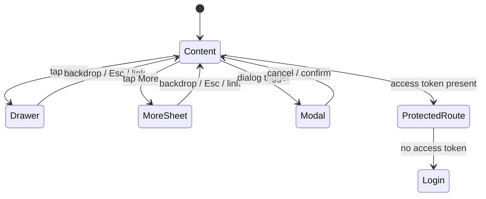

# 02 — Complete Mobile Wireframes

## Scope and conventions

- **Baseline viewport:** 390 × 844 px (iPhone 14/15 class), extending down to 360 px.
- **Navigation pattern:** compact top bar + modal drawer + fixed bottom navigation, matching current `AppShell.jsx`.
- **Wireframe type:** structured ASCII layouts with Mermaid transition diagram.
- **Separation:** **Existing implemented UI** vs **Proposed redesigned UI**.
- **Touch target baseline:** 44 × 44 px minimum; primary actions 48 px high.

## Global mobile shell — Existing implemented UI

```text
+--------------------------------+
| [☰] [S] SocialConnect     [@]  |
+--------------------------------+
|                                |
|          <Outlet />            |
|                                |
|                                |
+--------------------------------+
| Home | People | Friends | Chat | Alerts | More |
+--------------------------------+
```

Existing behaviour:

- Bottom bar: Home, People, Friends, Chat, Alerts, More.
- Drawer provides all primary and secondary links.
- Drawer has focus trap, backdrop close, Escape close, body-scroll lock.
- Top bar includes theme/account controls.
- Right rail does not appear; its content is reachable through pages.

## Global mobile shell — Proposed redesigned UI

```text
+--------------------------------+
| [SC] SocialConnect    [⌕] [☾] [av]|
+--------------------------------+
|                                |
|  page content (full-bleed)     |
|                                |
+--------------------------------+
| ⌂ Home  ◎ People  ♡ Friends  ✉ Chat  🔔 Alerts  ⋯ More |
+--------------------------------+
```

Proposed refinements:

- Use the compact `SC` mark instead of full wordmark in the top bar.
- Promote search to a top-bar icon; keep drawer for full navigation.
- Badge counts on Chat/Alerts remain.
- Bottom bar labels stay short; `More` opens a sheet, not a full drawer.



## Login / Register

### Existing implemented UI

```text
Login                          Register
+--------------------------+   +--------------------------+
| WELCOME TO SOCIALCONNECT |   | [SC] Create Account      |
| Welcome back             |   | Username [__________]    |
| Username [____________]  |   | Email    [__________]    |
| Password [____________]  |   | Password [__________]    |
| [Show] [ Log in ]        |   | Confirm  [__________]    |
| New here? Create account |   | [Create Account]         |
+--------------------------+   +--------------------------+
```

### Proposed redesigned UI

```text
+--------------------------+
| [SC]                     |
|                          |
| Welcome back             |
| Stay close to your circle|
|                          |
| Username or email [____] |
| Password          [____] |
| [ ] Remember   Forgot?*  |
|                          |
| [ Sign in ]              |
| New here? Create account |
+--------------------------+
```

`Forgot?` is proposed; backend reset API exists but no SPA route was found.

## Home feed

### Existing implemented UI

```text
+--------------------------------+
| YOUR COMMUNITY        [Refresh]|
| STORIES      [+] [av] [av] [av]|
+--------------------------------+
| [av] Share an update           |
| [ textarea .................. ]|
| [image v] [Audience: public v] |
| [ Publish ]                    |
+--------------------------------+
| Latest posts    Newest first   |
| [av] Name @user · 2h  [public] |
| text ........................ |
| [image]                        |
| [♥12][💬3][Share][Save]        |
| [comment...] [Comment]         |
+--------------------------------+
| Home People Friends Chat Alerts More |
+--------------------------------+
```

### Proposed redesigned UI

```text
+--------------------------------+
| HOME              [⌕] [Refresh]|
+--------------------------------+
| STORIES                        |
| + [You] [Ava] [Noah] [Mia] [›] |
+--------------------------------+
| [av] What's new with you?      |
| [media][audience ▾] [Publish]  |
+--------------------------------+
| [av] Ava  @ava · 18m  [Public] |
| Design systems update...       |
| [image card]                   |
| ♥ 24   💬 8   ↻ 3   [Save]     |
+--------------------------------+
| Home People Friends Chat Alerts More |
+--------------------------------+
```

Mobile feed rules:

- One post card per scroll focus; avoid side-by-side media galleries.
- Media height max 52vh; tap opens full-screen `MediaViewer`.
- Actions row wraps only at 360 px; otherwise stays in one line.
- Composer collapses to two lines until focused.

## Post detail

```text
Existing:                      Proposed:
+--------------------------+   +--------------------------+
| [<] SHARED POST          |   | [<] Post          [•••]  |
| [post card]              |   | [author row]             |
| [media]                  |   | [full media stage]       |
| [actions]                |   | [text]                   |
| [comments]               |   | [action bar]             |
+--------------------------+   | [threaded comments]      |
                               | [sticky reply bar]       |
                               +--------------------------+
```

## Profile

### Existing implemented UI

```text
+--------------------------------+
| [cover / No cover photo]       |
| [avatar] Display Name          |
| @username · bio · location     |
| [Edit profile OR actions]      |
| [N posts][N followers][N follow]|
| username's Posts               |
| [post card]                    |
+--------------------------------+
```

### Proposed redesigned UI

```text
+--------------------------------+
| [cover image]                  |
|       [avatar]                 |
|       Name ✓ @username         |
|       bio line                 |
|       📍 Location  🔗 Website  |
|                                |
| [Message][Follow][Add friend]  |
| [ N ] posts [ N ] followers [ N ] following |
+--------------------------+   |
| [ Posts ] [ Media ] [ About ]*|
| [post card]                   |
| [post card]                   |
+--------------------------------+
| Home People Friends Chat Alerts More |
+--------------------------------+
```

`Media`/`About` are proposed derived tabs; no new backend required.

## Edit profile

```text
+--------------------------------+
| [<] Edit profile               |
| [avatar preview] [Change]      |
| [cover preview]  [Change]      |
| First name [________________]  |
| Last name  [________________]  |
| Bio [........................] |
| Location [___________________] |
| Website [____________________] |
| [ ] Private profile            |
| Who can comment [Everyone ▾]   |
| Who can message [Everyone ▾]   |
| [ Save changes ]               |
+--------------------------------+
```

Proposed mobile refinement: group “Visibility & permissions” into a collapsible section; keep Save sticky at bottom with safe-area padding.

## Search / discover people

```text
Existing:                      Proposed:
+--------------------------+   +--------------------------+
| GROW YOUR COMMUNITY      |   | DISCOVER PEOPLE          |
| [ search... ] [Search]   |   | [ Search people...      ]|
| [av] Name @user          |   | [Suggested] [Results]    |
| [Follow][Add friend]     |   | [av] Name @user          |
| [av] Name @user          |   | @user · bio              |
| [Following][Request sent]|   | [Follow] [Add friend]    |
+--------------------------+   +--------------------------+
```

## Connections and friend requests

```text
Connections                    Friend requests
+--------------------------+   +--------------------------+
| YOUR COMMUNITY           |   | YOUR CONNECTIONS         |
| [Friends][Followers][Following] | [Received 3] [Sent]   |
| [av] Name @user ->       |   | [av] Name @user          |
| [av] Name @user ->       |   | [Accept] [Reject]        |
+--------------------------+   +--------------------------+
```

Proposed: horizontal swipe between tabs, sticky tab bar, mutual-friends chip* (backend endpoint exists).

## Bookmarks

```text
+--------------------------------+
| SAVED FOR LATER                |
| [Refresh]                      |
| [post card]                    |
| [post card]                    |
| No bookmarks -> Browse feed    |
+--------------------------------+
```

Proposed: add “Recently saved” grouping and per-card remove action using existing bookmark toggle.

## Messages

### Existing implemented UI

```text
Conversation list:             Chat view:
+--------------------------+   +--------------------------+
| YOUR INBOX        [+]    |   | [<] [av] Name [online]   |
| [search conversations]   |   | Today                    |
| [av] Name (2)            |   |      [other bubble]      |
| last message...          |   |             [own] ✓ Seen |
| [av] Name                |   | typing...                |
| No conversations -> Search|   | [Attach][message][Send]  |
+--------------------------+   +--------------------------+
```

### Proposed redesigned UI

```text
+--------------------------+
| MESSAGES            [+]  |
| [ Search conversations ] |
| [All] [Unread] [Groups*] |
| ┌──────────────────────┐ |
| │[av] Ava       ● 10:42│ |
| │ Attachment   (2)     │ |
| └──────────────────────┘ |
| [av] Noah  last message  |
+--------------------------+
```

Chat view proposed:

```text
+--------------------------+
| [<] [av] Ava  ● Online   |
+--------------------------+
| TODAY                    |
|      [received bubble]   |
|             [own bubble] |
|      [image attachment]  |
| typing dots              |
+--------------------------+
| [📎] [ Write a message ] [➤]|
+--------------------------+
```

Rules:

- Attachment-only send must be enabled in the proposed redesign; current UI blocks it.
- Read receipts appear only on own messages.
- Typing indicator reserves 20 px height to avoid layout jump.
- Keyboard should not cover composer; use `visualViewport` or safe-area aware sticky footer.

## Notifications

```text
Existing:                      Proposed:
+--------------------------+   +--------------------------+
| YOUR UPDATES             |   | NOTIFICATIONS  ● Live    |
| 3 unread · Live updates  |   | [All][Unread][Mentions]  |
| [Refresh][Mark all read] |   | [*] Ava liked your post  |
| [*] user liked your post |   | 2m · Open post           |
| [ ] user followed you    |   | [ Mark read ]            |
+--------------------------+   +--------------------------+
```

Proposed filters map to existing types: all, unread, likes/comments, mentions, friend requests.

## Stories: strip, creator, viewer

```text
Strip:                         Creator sheet:
+--------------------------+   +--------------------------+
| STORIES  [+] [You][Ava]  |   | [ media preview 16:9 ]   |
| [Noah][Mia][ › ]         |   | Caption [..............] |
+--------------------------+   | Privacy [public ▾]       |
                               | [ Share story ]          |
Viewer:                        +--------------------------+
+--------------------------+
| █████░░ [av] Ava · 2h [||][x]|
|                          |
|      image / video       |
|                          |
| caption text             |
| [‹]               [›]    |
+--------------------------+
```

Mobile story rules:

- Full-screen modal, no bottom nav visible.
- Progress bars sit above author header.
- Pause available for non-video only (matching existing behaviour).
- Story reactions are **proposed**; backend endpoint exists but no UI.

## Dialogs and sheets

```text
ConfirmDialog                  Notification settings
+--------------------------+   +--------------------------+
| !                        |   | Preferences         [x]  |
| Delete this post?        |   | Likes          [switch]  |
| This cannot be undone    |   | Comments       [switch]  |
| [Cancel] [Delete]        |   | Replies / Follows ...    |
+--------------------------+   | [Done]                   |
                               +--------------------------+

More sheet (proposed)          Media viewer
+--------------------------+   +--------------------------+
| Friend requests          |   | [‹] media [›]   [zoom]   |
| Saved posts              |   | caption                  |
| My profile               |   | [1/4]         [Close]    |
| Settings*                |   +--------------------------+
| [Close]                  |
+--------------------------+
```

`Settings` opens the existing notification settings dialog; no `/settings` route is proposed.

## Admin on mobile — Proposed

The current custom admin has responsive CSS but browser verification is historical. Proposed mobile admin:

```text
+--------------------------+
| [☰] ADMIN       [🔔] [av]|
+--------------------------+
| Overview                 |
| [Users][Posts][Reports]  |
| [1.2k][840][7]           |
| [ User Growth chart ]    |
| [ Recent activity ]      |
+--------------------------+
```

Proposed rules:

- Sidebar becomes off-canvas drawer.
- KPI grid becomes 2 columns at 390 px, 1 column at ≤360 px.
- Charts stack; tables become cards with key/value pairs.
- Moderation actions require confirmation.

## Mobile layout acceptance criteria

- No horizontal overflow at 360, 390, 430 px.
- Bottom nav height 64 px plus safe-area inset; content gets bottom padding 88 px.
- Touch targets ≥44 px; destructive confirmations require explicit tap.
- Dialogs/sheets never trap scroll behind them.
- Reduced-motion preference disables story auto-advance and transitions.
- All proposed additions are labelled as such in docs and review material.
