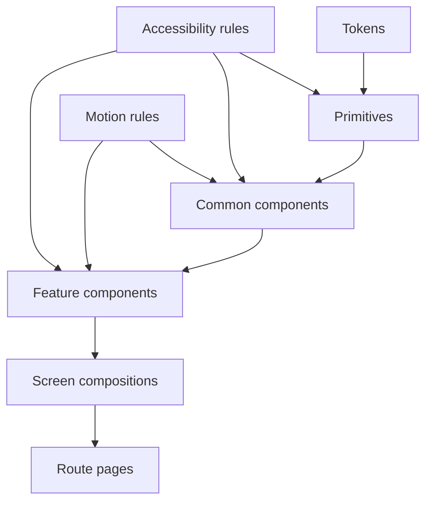
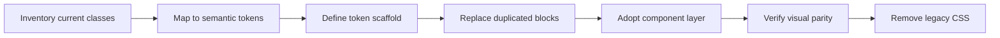

# 04 — Design System

## Purpose

This document defines the shared foundation for the proposed SocialConnect redesign. It formalises the visual language already present in the SPA while removing ambiguity caused by duplicated CSS blocks and inconsistent one-off styles.

## Existing implemented UI

The active visual system is hand-written CSS in `frontend/src/index.css`. It uses CSS custom properties, BEM-like class names, card surfaces, gradients, shadows, skeletons, and responsive breakpoints. `frontend/src/App.css` is largely stock Vite starter CSS and is not the active design source. Icons are inline SVG paths from `components/Icon.jsx`.

Observed foundations:

| Foundation | Current source evidence |
| --- | --- |
| Brand | Product name `SocialConnect`; square `S` mark. |
| Typography | `Plus Jakarta Sans` display, `Inter` body, system fallbacks. |
| Brand colours | Navy `#172554`, blue `#2563EB`, violet `#8B5CF6`, teal `#0D9488`, amber `#F59E0B`. |
| Surfaces | `#F8FAFC` app background, `#FFFFFF` cards, `#E2E8F0` borders. |
| Text | `#0F172A`, `#334155`, `#64748B`. |
| Radius | 12 px controls, 16–22 px cards, 999 px pills. |
| Motion | `0.25s cubic-bezier(0.4, 0, 0.2, 1)` and `0.45s cubic-bezier(0.34, 1.56, 0.64, 1)`. |
| Themes | `document.documentElement.dataset.theme` toggles light/dark; dark meta colour `#18191A`. |
| Accessibility | ARIA roles, focus rings, keyboard handling, focus traps, reduced-motion rules. |

## Proposed redesign principles

1. **One token source.** Every colour, space, radius, type size, and motion value has a semantic token.
2. **Calm density.** Generous whitespace and clear hierarchy; avoid visual noise in feeds and admin tables.
3. **Consistent state language.** Loading, empty, error, success, disabled, busy, and read/unread states share the same patterns.
4. **Feature truthfulness.** Proposed surfaces are visually distinct in review material and never presented as current behaviour.
5. **Accessibility by default.** Contrast, focus, target size, and reduced motion are design requirements, not optional enhancements.
6. **Responsive parity.** A feature's meaning survives the transition from desktop to mobile even when its layout changes.

---

## Token architecture

### Proposed naming convention

```css
--sc-color-{role}-{variant}
--sc-space-{step}
--sc-radius-{step}
--sc-font-{role}
--sc-size-{component}-{dimension}
--sc-shadow-{level}
--sc-motion-{duration|easing}
--sc-z-{layer}
```

### Proposed token scaffold

This is a documentation specification only; no source file is modified.

```css
:root {
  /* Colour roles */
  --sc-color-app: #F8FAFC;
  --sc-color-surface: #FFFFFF;
  --sc-color-surface-muted: #F1F5F9;
  --sc-color-surface-raised: #FFFFFF;
  --sc-color-border: #E2E8F0;
  --sc-color-border-strong: #CBD5E1;

  --sc-color-text: #0F172A;
  --sc-color-text-body: #334155;
  --sc-color-text-muted: #64748B;
  --sc-color-text-inverse: #FFFFFF;

  --sc-color-primary: #2563EB;
  --sc-color-primary-hover: #1D4ED8;
  --sc-color-primary-soft: #EFF6FF;
  --sc-color-violet: #8B5CF6;
  --sc-color-teal: #0D9488;
  --sc-color-amber: #F59E0B;
  --sc-color-danger: #DC2626;
  --sc-color-danger-soft: #FEF2F2;

  /* Spacing: 4 px rhythm */
  --sc-space-1: 4px;
  --sc-space-2: 8px;
  --sc-space-3: 12px;
  --sc-space-4: 16px;
  --sc-space-5: 20px;
  --sc-space-6: 24px;
  --sc-space-8: 32px;
  --sc-space-10: 40px;
  --sc-space-12: 48px;
  --sc-space-16: 64px;

  /* Radius */
  --sc-radius-sm: 8px;
  --sc-radius-md: 12px;
  --sc-radius-lg: 16px;
  --sc-radius-xl: 20px;
  --sc-radius-2xl: 24px;
  --sc-radius-pill: 999px;

  /* Elevation */
  --sc-shadow-sm: 0 1px 2px rgba(15, 23, 42, .06), 0 4px 12px rgba(15, 23, 42, .04);
  --sc-shadow-md: 0 2px 6px rgba(15, 23, 42, .06), 0 12px 28px rgba(15, 23, 42, .08);
  --sc-shadow-lg: 0 12px 40px rgba(15, 23, 42, .16);

  /* Motion */
  --sc-motion-fast: 160ms;
  --sc-motion-base: 250ms;
  --sc-motion-slow: 450ms;
  --sc-ease-standard: cubic-bezier(.4, 0, .2, 1);
  --sc-ease-spring: cubic-bezier(.34, 1.56, .64, 1);

  /* Layout */
  --sc-nav-h: 72px;
  --sc-sidebar-w: 264px;
  --sc-rail-w: 312px;
  --sc-content-max: 780px;

  /* Stacking */
  --sc-z-base: 0;
  --sc-z-sticky: 100;
  --sc-z-overlay: 1000;
  --sc-z-modal: 1100;
  --sc-z-toast: 1200;
}
```

Dark mode should override **semantic roles**, not component classes. For example, `--sc-color-surface` changes from white to a slate surface, while component CSS continues to reference the token.

---

## Spacing system

| Step | Value | Typical use |
| --- | --- | --- |
| 1 | 4 px | Icon-to-label gap, tight chip padding. |
| 2 | 8 px | Control gaps, action bar gaps. |
| 3 | 12 px | Form row gaps, comment indent. |
| 4 | 16 px | Card padding on dense cards, toast padding. |
| 5 | 20 px | Standard card padding. |
| 6 | 24 px | Section gaps, page gutters. |
| 8 | 32 px | Page top padding, large section separation. |
| 10 | 40 px | Empty-state vertical padding. |
| 12 | 48 px | Auth panel padding at large breakpoints. |
| 16 | 64 px | Marketing/auth side panel spacing. |

Rules:

- Use 4 px multiples only.
- Prefer 20 px card padding; use 16 px only for dense list rows.
- Never use margins for both siblings and parents; choose one layout owner.

---

## Radius and elevation

| Radius token | Value | Use |
| --- | --- | --- |
| `sm` | 8 px | Chips, small icon tiles, alerts. |
| `md` | 12 px | Inputs, buttons, small cards. |
| `lg` | 16 px | Standard cards, media thumbnails. |
| `xl` | 20 px | Post cards, profile cards, dialogs. |
| `2xl` | 24 px | Auth cards, large panels. |
| `pill` | 999 px | Badges, status pills, avatars. |

| Shadow token | Use |
| --- | --- |
| `sm` | Default cards and rail cards. |
| `md` | Hovered/interactive cards, dropdowns. |
| `lg` | Modals, drawers, media viewer, toasts. |

Do not combine large radius with heavy shadow on dense controls; the result reads as a modal rather than an inline action.

---

## Layout foundations

### Desktop shell

- Header 72 px sticky.
- Sidebar 264 px.
- Rail 312 px.
- Main content max 780 px.
- Card gap 20 px; page gutter 24 px.

### Mobile shell

- Header 56–60 px.
- Bottom navigation 64 px plus safe-area inset.
- Content bottom padding 88 px.
- Full-width cards with 16 px side gutters.
- Dialogs become bottom sheets where appropriate.

See `09-RESPONSIVE_LAYOUT_SPECIFICATIONS.md` for exact breakpoint behaviour.

---

## Component layers



| Layer | Contents | Examples |
| --- | --- | --- |
| Tokens | Raw values and semantic roles. | `--sc-color-primary`, `--sc-space-4`. |
| Primitives | Single-purpose UI atoms. | Button, Input, Badge, Avatar. |
| Common | Reusable composites. | Card, Dialog, Tabs, Skeleton, EmptyState. |
| Feature | Domain components. | PostCard, StoryCard, MessageBubble, KpiCard. |
| Screens | Route-level composition. | Home, UserProfile, Messages, Notifications. |

Feature components may not redefine token values locally. Exceptions require a documented token addition.

---

## State model

Every interactive component implements the same state vocabulary:

| State | Visual / behavioural contract |
| --- | --- |
| Default | Neutral surface, standard border. |
| Hover | Only on `(hover: hover) and (pointer: fine)`; 1–2 px lift or surface shift. |
| Focus | 2 px primary outline, 3 px offset; never removed without replacement. |
| Active / selected | Primary-tinted surface plus non-colour indicator. |
| Loading | Busy label or skeleton; `aria-busy="true"`; controls disabled but not hidden. |
| Disabled | 50–60% opacity, `not-allowed` cursor, no hover response. |
| Error | Danger border/text plus `role="alert"`; preserve user input. |
| Success | Teal confirmation; avoid colour-only meaning. |
| Empty | Illustration or icon, short explanation, one relevant CTA. |
| Unread | Blue/accent surface plus dot or label. |
| Read | Neutral surface; no colour-only reliance. |

---

## Motion and interaction

| Interaction | Duration / easing | Notes |
| --- | --- | --- |
| Hover, focus | 160 ms standard | Subtle; no layout shift. |
| Card lift | 250 ms standard | Translate ≤2 px. |
| Dialog open | 250 ms spring | Scale 0.98 → 1, opacity 0 → 1. |
| Drawer/sheet | 250 ms standard | Slide from edge. |
| Toast | 250 ms in / 160 ms out | Auto-dismiss only for non-critical notices. |
| Skeleton shimmer | 1.4 s loop | Disabled under reduced motion. |
| Story auto-advance | 5 s | Disabled under reduced motion. |

Rules:

- Animate transform and opacity, not layout properties.
- Skeleton geometry must match loaded geometry to prevent content jump.
- `prefers-reduced-motion: reduce` disables decorative animation; functional state changes remain instant.

---

## Iconography

- Use the existing inline SVG `Icon` system as the implementation bridge.
- 24 × 24 viewBox; 20 px default inline size; 16 px for dense rows; 28–32 px for KPI cards.
- Stroke 1.75–2 px, round caps and joins.
- Always pair icon-only controls with `aria-label` and visible tooltip on desktop.
- Do not use colour as the sole semantic signal: pair status icons with text.

Proposed icon set by domain:

| Domain | Icons |
| --- | --- |
| Navigation | home, search, users, messages, bell, bookmark, profile. |
| Content | plus, image, video, poll, calendar, pin, repost, share, flag. |
| Social | heart, comment, user-plus, check, block, friend-request. |
| System | sun, moon, settings, refresh, chevrons, close, more, warning. |
| Admin | dashboard, analytics, roles, database, shield, activity. |

---

## Content and voice

| Context | Voice | Example |
| --- | --- | --- |
| Page title | Concise noun phrase. | `Friend requests`, `Saved posts`. |
| Empty state | Empathetic and actionable. | `No saved posts yet — save something from your feed to find it here.` |
| Errors | Specific, non-blaming, recoverable. | `We couldn't load notifications. Try refreshing.` |
| Confirmations | Explicit consequence. | `Delete this post? This cannot be undone.` |
| Busy states | Verb in progress. | `Publishing…`, `Saving…`, `Marking…`. |

Avoid invented capability language. Do not say “Manage polls” when only vote exists.

---

## Migration from current CSS

### Existing problem

`frontend/src/index.css` contains repeated theme and responsive blocks, and `App.css` is legacy Vite CSS. This makes token ownership unclear.

### Proposed migration sequence



| Phase | Outcome | Acceptance |
| --- | --- | --- |
| 1 | Token inventory | Every hard-coded colour/spacing used more than once has a proposed token name. |
| 2 | Theme consolidation | Dark and light override tokens only, not component rules. |
| 3 | Component extraction | Shared cards, buttons, inputs, dialogs use one definition. |
| 4 | Responsive consolidation | One breakpoint map; no repeated range overrides. |
| 5 | Cleanup | Legacy `App.css` and unused sprite removed or documented. |

This migration is a design proposal only; no source changes are part of this package.

---

## Governance

| Artefact | Owner | Change rule |
| --- | --- | --- |
| Colour/type/spacing tokens | Design system | Add only when at least two screens need the value. |
| Component API | Component library | Breaking changes require migration note. |
| Feature component | Feature team | Must use primitives and tokens. |
| Screen layout | Product/design | Must respect responsive contract. |
| Proposed-only surface | Documentation | Must be labelled in review artefacts until implemented. |

### Definition of design-system compliance

A screen is compliant when:

- No raw hex colour appears in its component rules.
- All spacing comes from the 4 px scale.
- All interactive states are implemented.
- Keyboard and screen-reader behaviour is documented.
- Loading, empty, and error states are specified.
- Desktop, tablet, and mobile layouts are shown.
- Reduced-motion behaviour is handled.
