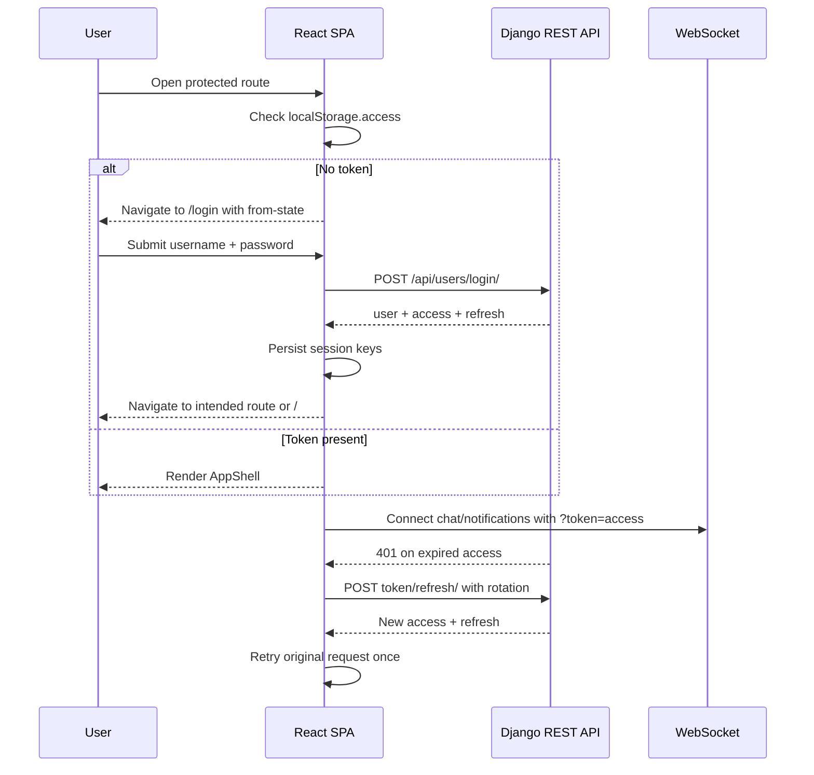
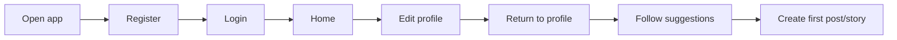
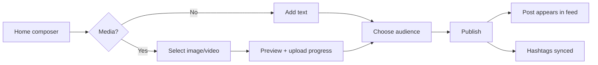
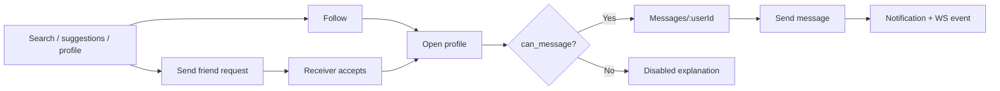
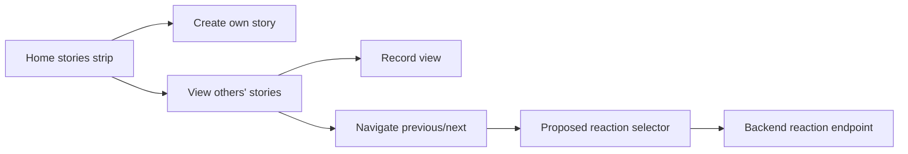
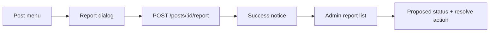

# 08 — User Navigation Flow

## Purpose

This document maps the SPA's real routes, authentication guard, deep links, and task flows. It also proposes navigation refinements without inventing unsupported routes.

**Source of truth:** `frontend/src/App.jsx`, `AppShell.jsx`, `navbar.jsx`, and source-confirmed link targets in the audit documents.

---

## Implemented route graph

```mermaid
flowchart TD
    Start([Open app]) --> Guard{access token in localStorage?}
    Guard -- No --> Login[/login]
    Guard -- Yes --> Shell[AppShell]

    Login --> Register[/register]
    Register --> Login
    Login --> Home[/ Home feed]

    Shell --> Home
    Shell --> ProfileRedirect[/profile redirect]
    ProfileRedirect --> UserProfile[/users/:userId]
    Shell --> UserProfile
    Shell --> PostDetail[/posts/:postId]
    Shell --> Search[/search]
    Shell --> EditProfile[/edit-profile]
    Shell --> Messages[/messages]
    Messages --> Chat[/messages/:userId]
    Shell --> Notifications[/notifications]
    Shell --> FriendRequests[/friend-requests]
    Shell --> Connections[/connections/:section]
    Shell --> Bookmarks[/bookmarks]

    Unknown[Any unknown path] --> Home
```

### Important source facts

- `/profile` is a redirect to `/users/<localStorage.user_id>`, not a standalone page.
- `Profile.jsx` is dead code; `UserProfile.jsx` is the active profile.
- There is **no** `/explore` page; exploration is `/search`.
- There is **no** `/settings` page; settings are dialogs and the Django admin.
- Guards check token presence only, not token validity.
- Login restores the intended destination from route state.

---

## Route inventory

| Route | Access | Primary entry points | Exit / next actions |
| --- | --- | --- | --- |
| `/login` | Public | Guard redirect, register success, logout. | `/`, intended destination. |
| `/register` | Public | Login link. | `/login`. |
| `/` | Protected | Navbar, sidebar, bottom nav, unknown-route redirect. | Stories, post detail, profile, search. |
| `/profile` | Protected | Profile menu/sidebar. | `/users/:userId`. |
| `/users/:userId` | Protected | Author links, search, connections, messages, notifications. | Edit profile, follow/friend/message/block, posts. |
| `/posts/:postId` | Protected | Post timestamp/link, notification deep link. | Back home, author profile, comments. |
| `/search` | Protected | Navbar search, People bottom nav. | Follow, friend request, profile. |
| `/edit-profile` | Protected | Own profile, sidebar/settings menu. | Save → profile events; cancel proposed. |
| `/messages` | Protected | Navbar, sidebar, bottom nav. | `/messages/:userId`. |
| `/messages/:userId` | Protected | Conversation list, profile message action. | Chat, back to list. |
| `/notifications` | Protected | Navbar Alerts, bottom nav. | Deep link to post/profile/request/message. |
| `/friend-requests` | Protected | Navbar/sidebar/More. | Accept/reject/cancel, profile. |
| `/connections/:section` | Protected | Profile stats, sidebar. | `friends`, `followers`, `following`. |
| `/bookmarks` | Protected | Sidebar/More/profile menu. | Post detail, author profile. |
| `/admin/` | Django staff/admin | Frontend URL link where permitted. | Admin dashboard/analytics/roles/system/changelists. |

---

## Authentication flow



### Existing caveats

- Route guard does not validate token expiry.
- WebSocket connections do not transparently refresh tokens.
- Tokens are readable by page JavaScript; see `SECURITY_ANALYSIS.md`.

### Proposed flow change

- Validate token shape/expiry before rendering protected routes.
- Use HttpOnly cookie refresh or short-lived WS ticket.
- Redirect to login with a non-sensitive `from` path only.
- Preserve deep-link destination after login.

---

## Primary task flows

### 1. New member onboarding



**Design requirements:**

- Register errors shown inline with `role="alert"`.
- Login success returns to intended destination.
- Edit profile failure offers Retry, not manual browser reload.
- Suggested people rail provides immediate follow/friend actions.

---

### 2. Publish content



**Proposed extensions:** poll creation and scheduling are backend-only/partial; do not present as current capability without completing backend work.

---

### 3. Social connection to messaging



**Design requirement:** current UI hides messaging when `can_message` is false; proposed design shows a disabled button with explanation.

---

### 4. Story engagement



**Status:** creation/viewing implemented; reaction UI proposed because the endpoint exists but no current surface was found.

---

### 5. Notification to target

```mermaid
flowchart LR
    A[Navbar badge / Alerts] --> B[Notifications]
    B --> C{Notification type}
    C -- like/comment/mention --> D[/posts/:postId]
    C -- follow/friend_request --> E[/users/:userId or /friend-requests]
    C -- message --> F[/messages/:userId]
    D --> G[Mark as read]
    E --> G
    F --> G
```

**Proposed fix:** mark read before or regardless of busy navigation so the item does not stay unread after opening.

---

### 6. Report and moderation



**Status:** submission implemented; moderation status/workflow not found. Proposed admin moderation screen must not claim a current resolve endpoint.

---

## Navigation chrome mapping

| Destination | Desktop navbar | Desktop sidebar | Mobile bottom bar | Mobile drawer | Right rail |
| --- | --- | --- | --- | --- | --- |
| Home | Yes | Yes | Home | Yes | Context suggestions. |
| Search people | Yes | Explore/Search | People | Yes | Suggestions. |
| Friends | Yes | Yes | Friends | Yes | Friend requests. |
| Messages | Yes | Yes | Chat | Yes | Shortcut. |
| Notifications | Yes | Yes | Alerts | Yes | Shortcut. |
| Friend requests | Badge/link | See more | More sheet | Yes | Incoming requests. |
| Bookmarks | Profile menu | See more | More sheet | Yes | Shortcut. |
| Own profile | Avatar menu | Profile card | More/avatar | Yes | — |
| Edit profile | Avatar menu | See more | More/avatar | Yes | — |
| Admin | Frontend URL link where allowed | — | — | — | — |

---

## Deep-link inventory

| Link source | Target | Behaviour |
| --- | --- | --- |
| Post author/time | `/users/:userId`, `/posts/:postId` | Profile or detail. |
| Comment mention | Proposed profile link | Current mention regex has punctuation bug. |
| Notification | Post/profile/request/message routes | Should mark read on open. |
| Conversation | `/messages/:userId` | Opens chat with selected peer. |
| Friend request | `/friend-requests`, `/users/:id` | Manage or inspect sender. |
| Connections stat | `/connections/:section` | friends/followers/following. |
| Saved post | `/bookmarks` and post detail | Maintain back context. |
| Admin frontend link | `settings.FRONTEND_URL` | Staff-only admin navigation. |

---

## Proposed navigation improvements

| ID | Improvement | Rationale |
| --- | --- | --- |
| N-01 | Group sidebar into Discover / Connect / Communicate / Library. | Reduces scanning load; preserves all routes. |
| N-02 | Add skip-to-content link. | Keyboard accessibility. |
| N-03 | Show disabled messaging explanation. | Makes `can_message=false` understandable. |
| N-04 | Context-aware right rail. | Useful content by task instead of generic cards. |
| N-05 | Add keyboard shortcut for people search (`Ctrl/Cmd+K`). | Power-user efficiency; focus SearchField. |
| N-06 | Add shared pagination to all list pages. | Backend `next` is currently ignored outside home. |
| N-07 | Validate token expiry in guard. | Avoid misleading authenticated shell with expired token. |
| N-08 | Add route-level error boundary. | Graceful recovery instead of blank screen. |
| N-09 | Use bottom sheet for More on mobile. | Faster than full drawer for secondary actions. |
| N-10 | Preserve return path after notification deep link. | Clear Back behaviour. |

Proposed route additions are deliberately avoided. Polls, groups, password reset, and settings remain backend-only or dialog-based until implemented.

---

## Navigation states

| State | UI treatment |
| --- | --- |
| Protected route, no token | Redirect `/login`, preserve `from`. |
| Token present but invalid | Proposed: clear session and redirect with neutral message. |
| Loading route data | Skeleton matching destination layout. |
| Empty list | Explanation + primary CTA. |
| Error | Inline error with Retry. |
| Offline / reconnecting | Non-blocking status banner; preserve queued intent where safe. |
| Unread badge | Count + accessible label. |
| Deep link to hidden/blocked resource | Neutral unavailable state; do not reveal private details. |
| Unknown route | Redirect `/` as current source does. |

---

## Acceptance criteria

- Every current route is reachable from at least one navigation surface or documented deep link.
- No proposed-only route is shown in current-behaviour diagrams.
- Login destination restoration works after refresh attempt.
- Back navigation from detail pages returns to the originating list where feasible.
- Keyboard users can reach all navigation destinations and skip repeated content.
- Mobile drawer and More sheet preserve focus and close behaviour.
- Unread badges update after reads and custom refresh events.
- Deep links respect privacy, block, and visibility rules.
