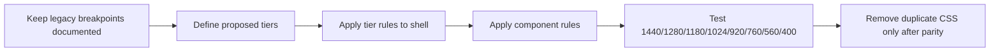

# 09 — Responsive Layout Specifications

## Purpose

This document defines the responsive behaviour for the proposed redesign. It preserves the SPA's existing breakpoints while introducing a cleaner, documented system for replacing duplicated CSS rules.

**Existing implemented UI:** responsive rules are hand-written in `frontend/src/index.css` with many breakpoints. **Proposed:** one breakpoint map, one grid contract, and explicit column behaviour.

---

## Existing breakpoints found in source

| Breakpoint | Observed role |
| --- | --- |
| 1320 px | Wide desktop adjustments. |
| 1180 px | Sidebar/rail transition. |
| 1100 px | Mid-desktop compression. |
| 920 px | Tablet layout changes. |
| 760 px | Mobile shell threshold. |
| 560 px | Dense card/form adjustments. |
| 520 px | Tighter mobile spacing. |
| 500 px | Small phone adjustments. |
| 480 px | Compact action rows. |
| 420 px | Very small typography/spacing. |
| 400 px | Minimum-width safeguards. |

## Proposed breakpoint map

| Tier | Range | Layout mode |
| --- | --- | --- |
| XL | ≥1280 px | Full three-column desktop. |
| L | 1024–1279 px | Sidebar + main; rail collapses. |
| M | 761–1023 px | Icon rail/sidebar; main expands; rail hidden. |
| S | 561–760 px | Mobile shell: top bar + bottom nav. |
| XS | 401–560 px | Compact mobile; stacked cards. |
| XXS | ≤400 px | Minimum-width safeguards; no horizontal overflow. |

The proposed map intentionally reduces overlapping breakpoints. Migration should verify visual parity at all legacy widths before removing old rules.

---

## Desktop grid — XL

```text
┌──────────────────────────────────────────────────────────────┐
│ Header 72px                                                  │
├────────────┬────────────────────────────────┬────────────────┤
│ Sidebar    │ Main content                   │ Rail           │
│ 264px      │ max 780px, centered            │ 312px          │
│ fixed      │ 24px gutters                   │ sticky         │
└────────────┴────────────────────────────────┴────────────────┘
```

| Property | Value |
| --- | --- |
| Header height | 72 px. |
| Sidebar width | 264 px. |
| Rail width | 312 px. |
| Content max | 780 px. |
| Grid gap | 24 px. |
| Page padding | 24 px horizontal, 32 px top. |
| Card gap | 20 px. |
| Sticky offset | `calc(72px + 16px)` for sticky side content. |

At very wide screens (>1600 px), keep content centred; do not stretch post text beyond 780 px.

---

## Desktop transitions

| Width | Sidebar | Main | Rail |
| --- | --- | --- | --- |
| ≥1280 | 264 px, full labels. | 780 px centred. | 312 px visible. |
| 1180–1279 | 240 px, full labels. | Fluid, max 760 px. | 280 px or hidden on dense pages. |
| 1024–1179 | 220 px or icon rail. | Fluid, max 760 px. | Hidden. |
| 921–1023 | Icon rail 76 px. | Fluid, max 720 px. | Hidden. |
| 761–920 | No persistent sidebar. | Full width with 24 px gutters. | Hidden. |

Rules:

- Collapse the rail before collapsing the sidebar.
- Use icon-only sidebar only when labels can be restored via tooltip and accessible name.
- Do not hide unread badges when navigation collapses.

---

## Mobile shell — S / XS / XXS

```text
┌──────────────────────────────┐
│ Header 56–60px               │
├──────────────────────────────┤
│ Content: 16px side gutters   │
│ Bottom padding: 88px         │
├──────────────────────────────┤
│ Bottom nav 64px + safe area  │
└──────────────────────────────┘
```

| Property | S (561–760) | XS (401–560) | XXS (≤400) |
| --- | --- | --- | --- |
| Side gutter | 20 px | 16 px | 12 px |
| Card padding | 20 px | 16 px | 14 px |
| Card radius | 20 px | 16 px | 16 px |
| Bottom nav | 64 px | 64 px | 60 px |
| Content bottom padding | 88 px | 88 px | 84 px |
| H1 | 24 / 32 | 24 / 32 | 22 / 30 |
| Body | 14 / 21 | 14 / 21 | 14 / 21 |
| Action row | One line | Wrap at 420 px | Wrap, hide non-critical labels |

---

## Component behaviour by breakpoint

| Component | XL / L | M | S / XS / XXS |
| --- | --- | --- | --- |
| Navbar | Full nav + search + icons. | Reduced nav; search prominent. | Brand, search icon, theme/avatar. |
| Sidebar | Full labelled nav. | Icon rail. | Modal drawer. |
| Right rail | Context cards. | Hidden. | Content via dedicated pages. |
| Home feed | 780 px column. | Fluid single column. | Full-width cards. |
| Stories strip | Horizontal scroll in main column. | Horizontal scroll. | Edge-to-edge scroll with snap. |
| Composer | Expanded control row. | Two rows. | Collapsed; expand on focus. |
| Post media | 16:9 max stage. | 16:9. | Max 52vh; tap opens viewer. |
| Comments | Nested with 24 px indent. | Nested with 20 px indent. | Indent capped at 12 px per level; collapse deep threads. |
| Profile | Cover 240 px; centred identity. | Cover 200 px. | Cover 160 px; actions wrap. |
| Messages | Two-pane 320 px + chat. | 280 px + chat. | One pane: list or chat. |
| Notifications | Wide list cards. | Single column. | Compact cards with 16 px padding. |
| Dialogs | Centred modal 480–640 px. | Centred modal. | Bottom sheet or near-fullscreen. |
| Admin KPI grid | 4 columns. | 2–3 columns. | 1–2 columns; cards compact. |
| Admin tables | Full table. | Scrolling table. | Key/value cards. |

---

## Touch targets and spacing

| Element | Minimum size |
| --- | --- |
| Primary buttons | 48 px height. |
| Secondary/icon buttons | 44 × 44 px. |
| Nav items | 44 px height. |
| Inputs/selects | 48 px height. |
| Tabs | 44 px height. |
| Story navigation | 44 px circle. |
| Message send | 44 px circle or 48 px button. |
| Checkbox/switch hit area | 44 × 44 px including padding. |
| Spacing between destructive actions | ≥8 px. |

Rules:

- Touch targets may be visually smaller if the hit area meets the minimum.
- Do not place two destructive actions adjacent without separation.
- Bottom navigation labels use 11–12 px and keep icons ≥20 px.

---

## Safe areas and scroll behaviour

```css
:root {
  --sc-safe-top: env(safe-area-inset-top, 0px);
  --sc-safe-bottom: env(safe-area-inset-bottom, 0px);
}

.mobile-shell {
  padding-top: var(--sc-safe-top);
}

.mobile-content {
  padding-bottom: calc(88px + var(--sc-safe-bottom));
}
```

- Sticky headers respect safe-area top.
- Chat composer and bottom nav respect safe-area bottom.
- Body scroll is locked only while a modal/drawer owns focus.
- Infinite-scroll sentinel must not overlap bottom nav.
- Use `visualViewport` awareness for chat composer where available.

---

## Responsive images and media

| Media | Rule |
| --- | --- |
| Avatars | Fixed px sizes; object-fit cover. |
| Post image | Width 100%, max-height 520 px desktop / 52vh mobile, object-fit cover. |
| Post video | Same stage as image; native controls; fullscreen on tap. |
| Story media | 9:16 stage, max-height 78vh. |
| Cover photo | Height by breakpoint; object-position centre. |
| Attachment thumb | 64 × 64 px, 8 px radius. |
| Admin chart | Responsive canvas width; fixed height 320 px. |

Always provide failed-media state with a neutral placeholder and accessible message.

---

## Typography responsiveness

See `06-TYPOGRAPHY_SYSTEM.md`. Key rule: reduce heading size at mobile, not body readability. Body remains ≥14 px.

---

## Motion responsiveness

- Drawer/modal transitions disabled under `prefers-reduced-motion`.
- Story auto-advance disabled under reduced motion.
- Infinite-scroll skeleton shimmer disabled under reduced motion.
- Hover lifts gated by `(hover: hover) and (pointer: fine)`.

---

## Zoom and small screen resilience

| Requirement | Acceptance |
| --- | --- |
| 200% browser zoom | No horizontal scrolling on feed, profile, messages, notifications. |
| 320 px effective width | Content remains readable; actions wrap; no clipped buttons. |
| Long names | Ellipsis with full text in title/tooltip. |
| Long URLs in profile | Break with `overflow-wrap: anywhere`. |
| Large media | Contained within viewport width. |
| Admin tables | Convert to cards below 760 px. |

---

## Proposed migration method



Do not delete legacy rules until each tier has visual parity screenshots or recorded review evidence.

---

## Responsive acceptance criteria

- Full three-column shell visible at ≥1280 px.
- Rail hidden before sidebar collapses.
- Mobile drawer and bottom navigation behave at ≤760 px.
- No horizontal overflow at 360, 390, or 430 px.
- Touch targets meet minimums on mobile.
- Dialogs and sheets do not trap background scroll.
- Media never exceeds viewport height on mobile.
- Admin tables and KPI cards reflow predictably.
- Reduced motion and safe-area rules are implemented.
