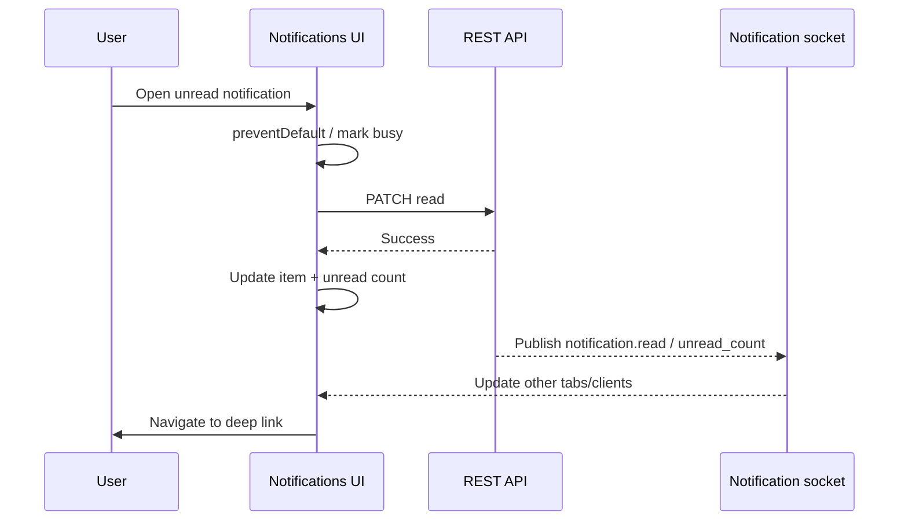

# 15 — Notification Design

## Purpose

This document specifies the notification list, live status, type presentation, read flows, preferences, deep links, and proposed real-time/read-state improvements.

## Existing implemented UI

`Notifications.jsx` provides:

- Notification list with type-specific icons and messages.
- Unread styling.
- Live connection status.
- Refresh and mark-all-read.
- Mark-one-read.
- Deep links to targets.
- WebSocket connection to `/ws/notifications/?token=<access>` with reconnect backoff.
- `NotificationSettingsDialog.jsx` with eight preference switches using optimistic updates and rollback.
- Navbar unread badge polled from `/api/notifications/unread-count/` every 60 s and updated by custom events.

### Current limitations

- Read actions emit no WebSocket update, so other tabs/clients keep stale state.
- A busy unread notification can navigate without being marked read because `preventDefault()` occurs after an early return.
- No pagination.
- Unread-count probe responses are discarded.
- Filters are limited/absent compared with the proposed design.

---

## Notification types

| Type | Typical message | Icon family | Deep link |
| --- | --- | --- | --- |
| `like` | `Ava liked your post.` | Heart. | `/posts/:postId`. |
| `comment` | `Noah commented on your post.` | Comment. | `/posts/:postId`. |
| `reply` | `Mia replied to your comment.` | Reply. | `/posts/:postId`. |
| `follow` | `Leo started following you.` | User plus. | `/users/:userId`. |
| `friend_request` | `Iris sent you a friend request.` | Friend request. | `/friend-requests` or `/users/:id`. |
| `message` | `Omar sent you a message.` | Message. | `/messages/:userId`. |
| `mention` | `You were mentioned in a comment.` | At sign. | `/posts/:postId`. |
| `story_reaction` | `Ava reacted to your story.` | Reaction/star. | Proposed story deep link. |

Rules:

- Message text is generated server-side or from serializer fields; UI should not invent details.
- Masked `post`/`comment` IDs must not deep-link if no longer visible.
- Blocked/private targets show neutral unavailable state.

---

## Proposed desktop layout

```text
┌────────────────────────────────────────────────────────────────────────┐
│ NOTIFICATIONS                       ● Live   [Refresh] [Mark all read] │
│ [All] [Unread 3] [Mentions] [Requests]                      [Settings] │
│ ┌────────────────────────────────────────────────────────────────────┐ │
│ │ [icon] Ava liked your post                    2m        [•••]      │ │
│ │ "Design systems update…" → Open post                             │ │
│ │ [Mark read]                                                       │ │
│ └────────────────────────────────────────────────────────────────────┘ │
│ [icon] Noah started following you             1h                      │
│ [icon] Mia replied to your comment            3h                      │
└────────────────────────────────────────────────────────────────────────┘
```

| Element | Specification |
| --- | --- |
| Page title | H1 28/36 display bold. |
| Live status | 8 px dot + 12 px text: Live / Reconnecting / Offline. |
| Filters | 44 px segmented tabs; unread badge count. |
| Item card | 16 px padding, 12 px radius, 8–12 px vertical gap. |
| Icon tile | 40 × 40 px, 12 px radius, type-specific soft colour. |
| Timestamp | 12 px muted, right aligned. |
| Preview | 14 px, max two lines. |
| CTA | 14 px semibold link. |
| Unread | Soft blue surface + 2 px left accent + bold title. |
| Read | Neutral surface; normal weight. |

---

## Proposed mobile layout

```text
┌──────────────────────────────┐
│ NOTIFICATIONS  ● Live        │
│ [All][Unread 3][Mentions]    │
│ ┌──────────────────────────┐ │
│ │ [icon] Ava liked your    │ │
│ │ post              2m     │ │
│ │ Open post                │ │
│ │ [Mark read]              │ │
│ └──────────────────────────┘ │
│ [icon] Noah followed you     │
└──────────────────────────────┘
```

Mobile rules:

- 16 px side gutters.
- Filters horizontally scrollable.
- Actions stack below preview at ≤420 px.
- Bottom nav remains visible; content padding 88 px.
- Mark-read control remains ≥44 px.

---

## Notification item anatomy

```text
┌──────────────────────────────────────────────┐
│ [icon] Title text                 timestamp  │
│        Preview text (optional)               │
│        [Open target]          [Mark read]    │
└──────────────────────────────────────────────┘
```

### Item states

| State | Treatment |
| --- | --- |
| Unread | Soft blue surface, left accent, bold title. |
| Read | Neutral surface, normal weight. |
| Busy | `Marking…` label; controls disabled. |
| Live-arrived | Brief highlight fade, disabled under reduced motion. |
| Link unavailable | `Open` disabled with `Unavailable` label. |
| Grouped* | Proposed: `Ava and 3 others liked your post.` |
| Error | Retry control; preserve item state. |

---

## Read flow

### Existing behaviour

- `PATCH /api/notifications/<pk>/read/`.
- `POST /api/notifications/read-all/`.
- Local state updates after success.
- No WebSocket update to other clients.

### Proposed flow



### Required fixes

1. Call `preventDefault()` before any early return for unread notifications.
2. Mark read even if navigation target is busy or blocked.
3. Publish read-state events from the backend.
4. Use unread-count probe response instead of discarding it.
5. Add pagination/loading-more for long lists.

---

## Filters

| Filter | Source | Status |
| --- | --- | --- |
| All | All notifications. | Proposed. |
| Unread | `is_read=false`. | Proposed. |
| Mentions | `mention` type. | Proposed. |
| Requests | `friend_request` type. | Proposed. |
| Likes/comments | `like`, `comment`, `reply`. | Proposed. |
| Stories | `story_reaction`. | Proposed. |

Filters should be client-side initially because the API has no filter query documented. Server-side filters require new API parameters.

---

## Preferences dialog

### Existing eight switches

- `likes`
- `comments`
- `replies`
- `follows`
- `friend_requests`
- `messages`
- `mentions`
- `story_reactions`

### Proposed specification

```text
┌──────────────────────────────────────────┐
│ Notification preferences          [×]    │
│ Choose what you want to hear about.      │
│ Likes                         [switch]   │
│ Comments                      [switch]   │
│ Replies                       [switch]   │
│ Follows                       [switch]   │
│ Friend requests               [switch]   │
│ Messages                      [switch]   │
│ Mentions                      [switch]   │
│ Story reactions               [switch]   │
│                                          │
│ [Done]                                   │
└──────────────────────────────────────────┘
```

Rules:

- `role="switch"` with `aria-checked`.
- Optimistic update with rollback on failure, matching source behaviour.
- Busy state per switch, not global.
- Error explains which preference failed.
- Preference changes affect future notifications only.

---

## Live connection states

| State | Visual | Behaviour |
| --- | --- | --- |
| Connected | Teal dot + `Live`. | Receive WS notifications. |
| Connecting | Amber dot + `Connecting…`. | Initial handshake. |
| Reconnecting | Amber dot + `Reconnecting…`. | Backoff; show non-blocking banner. |
| Offline | Slate dot + `Offline`. | Refresh button available. |
| Auth expired | Neutral `Session expired`; proposed re-auth path. | Current WS closes. |

---

## Navbar badge integration

- Badge count from `unread-count/`.
- Poll every 60 s in current source.
- Proposed: WS push plus polling fallback.
- Badge has accessible label `N unread notifications`.
- Badge clears on read-all and individual read.
- Count must not go negative during optimistic updates.

---

## Empty, loading, error states

| State | Treatment |
| --- | --- |
| Loading | Five notification row skeletons. |
| Empty | `You're all caught up.` CTA `Refresh`. |
| No filter results | `No unread notifications.` clear filter. |
| Error | Retry card with non-technical message. |
| Pagination loading | Rows + `Loading more…`. |
| Pagination error | `Load more` retry. |
| Deep-link error | Neutral unavailable state. |

---

## Accessibility requirements

- List uses semantic list structure.
- Unread state exposed as text or `aria-current`/label, not colour alone.
- Live status uses `role="status"` politely.
- New notification announcements avoid interrupting typing.
- Mark-read buttons have unique accessible names including notification title.
- Deep links are real links/buttons with keyboard support.
- Preferences dialog traps focus and restores.
- Reduced motion disables arrival highlight.

---

## Acceptance criteria

- All eight notification types render correctly with safe deep links.
- Read actions mark items before navigation and update counts.
- Live status accurately reflects WebSocket state.
- Preferences use switches with rollback.
- Proposed filters/pagination are labelled until implemented.
- Read-state WS updates are implemented in proposed backend work.
- All loading/empty/error states are present.
