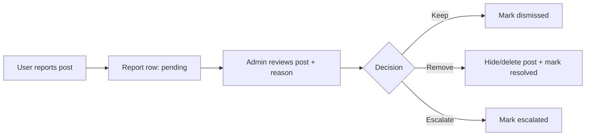

# 16 — Admin Panel Design

## Purpose

This document specifies the custom Django admin experience, including its 12 real-data KPIs, analytics ranges, roles, system status, moderation proposal, responsive behaviour, and known defects.

## Existing implemented UI

The custom admin is **not part of the React SPA**. It is wired through:

- `config.admin.SocialConnectAdminConfig`
- `config/admin_site.py` → `SocialConnectAdminSite`
- `backend/templates/admin/` overrides
- `backend/static/admin/` styles/scripts
- `config/admin_metrics.py` for real aggregates

Implemented areas:

- Custom dashboard with 12 KPI cards.
- Analytics page with 7/30/90-day ranges and six-month series.
- Roles & permissions page.
- System status page for superusers.
- Searchable sidebar, dark theme, confirmation modal, toasts, canvas charts, responsive layout, reduced-motion rules.
- Permission-gated aggregates and navigation.

### Known source defects

- Likes KPI links to Posts instead of Likes.
- Pending Reports counts all reports because `PostReport` has no status field.
- AdminAction is not a reliable audit source.
- Historical reports incorrectly say eight KPI cards; current source has 12.
- Browser smoke verification is historical/partial, so current visual behaviour is `Needs Verification`.

---

## Admin shell

```text
┌──────────────────────────────────────────────────────────────────────────────┐
│ [SC] ADMIN     [scope: Users/Posts/Comments] [search] [🔔 n] [☾] [avatar ▾] │
├─────────────────────┬────────────────────────────────────────────────────────┤
│ DASHBOARD           │ H1 Overview                    [Last 30 days ▾]        │
│ Analytics           │                                                        │
│ Users               │ 12 KPI cards in a 4 × 3 grid                            │
│ Posts               │ ┌──────────────────────┬──────────────────────┐         │
│ Comments            │ │ Registrations line   │ Engagement bar       │         │
│ Likes               │ └──────────────────────┴──────────────────────┘         │
│ Stories             │ Recent Users | Recent Posts | Admin Activity           │
│ Reports             │                                                        │
│ Roles               │                                                        │
│ Activity            │                                                        │
│ System              │                                                        │
└─────────────────────┴────────────────────────────────────────────────────────┘
```

| Element | Proposed specification |
| --- | --- |
| Sidebar | 248 px, permission-aware groups, searchable items. |
| Topbar | 64 px, brand mark, scope selector, global search, notification badge, theme, avatar. |
| Content | Fluid with 24 px padding; max 1600 px. |
| KPI grid | 4 cols ≥1280, 3 cols 1024–1279, 2 cols 761–1023, 1–2 cols ≤760. |
| Card gap | 16 px. |
| Chart height | 320 px. |
| Table row | 44 px; sticky header. |
| Toast | Top-right, 12 px radius, shadow `lg`, auto-dismiss for non-critical notices. |

---

## KPI cards

### Existing 12 metrics from `admin_metrics.py`

| # | Label | Description / source | Trend | Permission |
| --- | --- | --- | --- | --- |
| 1 | Total Users | Registered accounts | New users vs previous 30 d | users |
| 2 | Active Users | Distinct users issued a refresh token in 30 days | Same window comparison | users |
| 3 | Total Posts | All published and draft posts | New posts | posts |
| 4 | Total Comments | Top-level comments and replies | New comments | comments |
| 5 | Pending Reports | All reports; no status field exists | New reports | reports |
| 6 | Total Likes | Post reactions recorded | New likes | likes |
| 7 | New Registrations | Accounts created in last 30 days | Previous-window comparison | users |
| 8 | Friend Requests | Pending right now | Created requests | friend_requests |
| 9 | Total Stories | All active and expired stories | None | stories |
| 10 | Active Stories | Not yet expired | None | stories |
| 11 | Expired Stories | Past 24-hour expiry | None | stories |
| 12 | Total Story Reactions | All reactions; unavailable if table missing | None | story_reactions |

### KPI card anatomy

```text
┌──────────────────────────────┐
│ [icon]  TOTAL USERS          │
│ 1,284                        │
│ Registered accounts          │
│ ▲ +42 vs previous 30d        │
└──────────────────────────────┘
```

| Element | Specification |
| --- | --- |
| Icon tile | 32 × 32 px, 8 px radius, accent soft surface. |
| Label | 11 px uppercase, muted, 0.08em tracking. |
| Value | 28/32 numeric bold, tabular numerals. |
| Description | 12 px muted, max two lines. |
| Trend chip | 11 px semibold; teal up, danger down, slate flat. |
| Permission masked | Value `—` with `No access` tooltip. |
| Unavailable relation | Neutral `Unavailable` value and explanation. |
| Click target | Whole card where a changelist link is valid. |

### Required KPI fixes

| Card | Fix |
| --- | --- |
| Total Likes | Link to Likes changelist, not Posts. |
| Pending Reports | Keep label only until status exists, or relabel `Total Reports`; proposed status workflow will make it accurate. |
| Story Reactions | Preserve unavailable-table handling; never show estimated values. |

---

## Analytics page

### Existing data

- Range options: 7, 30, 90 days; invalid values normalise to 30.
- Daily labels and counts for registrations, posts, comments, likes, friend requests created/accepted, reports, messages, notifications.
- Active users derived from outstanding refresh tokens.
- Cumulative registrations.
- Six-month monthly active users and monthly labels.
- Permission masking returns zeros where access is denied.

### Proposed layout

```text
┌────────────────────────────────────────────────────────────────────────┐
│ Analytics                         [7d] [30d] [90d]      [Export]*      │
│ ┌────────────────────────────────┬───────────────────────────────────┐ │
│ │ Registrations (cumulative)     │ Posts & Comments                  │ │
│ │ line chart                     │ bar chart                         │ │
│ └────────────────────────────────┴───────────────────────────────────┘ │
│ ┌────────────────────────────────┬───────────────────────────────────┐ │
│ │ Engagement                     │ Monthly Active Users              │ │
│ │ combined bars                  │ six-month line                    │ │
│ └────────────────────────────────┴───────────────────────────────────┘ │
└────────────────────────────────────────────────────────────────────────┘
```

`Export*` is proposed only; no export endpoint exists.

### Chart rules

- Use real aggregates only; no placeholder data.
- Show labels and legend outside canvas.
- Grid lines at low opacity.
- Permission-masked series use neutral `No access` note rather than misleading zero lines where appropriate.
- Empty series show `No activity in this range`.
- Tooltips include date and value.
- Reduced motion disables chart entry animation.

---

## Roles & permissions page

### Existing behaviour

- Superusers or users with `auth.view_group` can access.
- Shows groups annotated with user count and permission count.
- Shows role labels, staff/superuser status, direct permission count.
- Links to Group and User changelists.
- Display-only; no role assignment implemented in this custom page.

### Proposed design

```text
Roles & Permissions
[Superadmin] [Moderator] [Support]

┌──────────────────────────────────────────┐
│ Moderator        12 users · 8 permissions │
│ Can: view posts, comments, reports        │
│ [Manage group]                            │
└──────────────────────────────────────────┘
```

Rules:

- Keep display-only unless explicit management with audit trail is implemented.
- Use permission-driven rendering, not hard-coded role names for access decisions.
- Link to Django group admin for actual changes.

---

## System status page

### Existing behaviour

- Superuser-only.
- Checks database connection.
- Reports channel backend from `CHANNEL_LAYERS`.
- Uses Django settings-derived values; no secrets should be displayed.

### Proposed design

| Status item | Display |
| --- | --- |
| Database | Connected / Unavailable + checked time. |
| Channel layer | Redis-backed / In-memory + explicit warning when in-memory. |
| Site URL | `FRONTEND_URL`. |
| Debug mode | On/Off; warn when On in production. |
| Static/media | Proposed check once deployment strategy exists. |
| Email | Proposed check once backend configured. |
| Recent errors | Proposed log-based integration; not currently implemented. |

Rules:

- Never display secret key, password, token, DSN credentials, or private env values.
- Show configuration state, not raw values.
- In-memory channel layer warning: `Single-process development only; use Redis for production.`

---

## Moderation proposal

### Existing gap

Reports can be created from the feed but there is no status field, resolve endpoint, or moderation action.

### Proposed workflow



### Proposed UI

- Reports table with post author, reason, reporter, timestamp, status.
- Filters: Pending, Dismissed, Resolved, Escalated.
- Detail panel with post preview and report history.
- Actions require confirmation.
- Pending KPI reflects only `pending` rows after backend status is added.
- Audit entries should use a real audit model; current `AdminAction` is not sufficient.

**Status:** Proposed. Do not implement UI labels implying current resolve capability.

---

## Responsive admin

| Width | Sidebar | KPI grid | Charts | Tables |
| --- | --- | --- | --- | --- |
| ≥1280 | Full 248 px | 4 columns | 2 columns | Full table. |
| 1024–1279 | Collapsible | 3 columns | 2 columns | Full table. |
| 761–1023 | Icon/off-canvas | 2 columns | 1 column | Horizontal scroll. |
| ≤760 | Off-canvas drawer | 1–2 columns | 1 column stacked | Key/value cards. |
| ≤400 | Drawer | 1 column | Stacked | Cards, condensed. |

Admin mobile pattern:

```text
┌──────────────────────────────┐
│ [☰] ADMIN       [🔔] [avatar]│
├──────────────────────────────┤
│ Overview                     │
│ [Users][Posts][Reports]      │
│ [1.2k][840][7]               │
│ [ User growth chart ]        │
│ [ Recent activity cards ]    │
└──────────────────────────────┘
```

---

## Accessibility requirements

- Sidebar navigation is labelled and keyboard reachable.
- Active item uses `aria-current="page"`.
- Charts have text alternatives or data tables.
- Toasts use `role="status"`; errors use `role="alert"`.
- Confirmation modal is `role="alertdialog"` with focus trap.
- KPI links have descriptive labels including metric name.
- Tables use proper headers and scope.
- Dark mode meets text contrast.
- Reduced motion disables transitions and chart animation.

---

## Acceptance criteria

- All 12 KPI cards render with real data and correct permission masking.
- Likes KPI link is corrected.
- Reports label is accurate or temporary explanation is visible.
- Analytics ranges 7/30/90 work with real series.
- Roles and system pages respect permission gates.
- System page exposes configuration state only, never secret values.
- Responsive behaviour matches the table above.
- Moderation workflow is labelled proposed until backend status/actions exist.
- Current browser smoke status remains `Needs Verification` until a fresh authenticated run is recorded.
