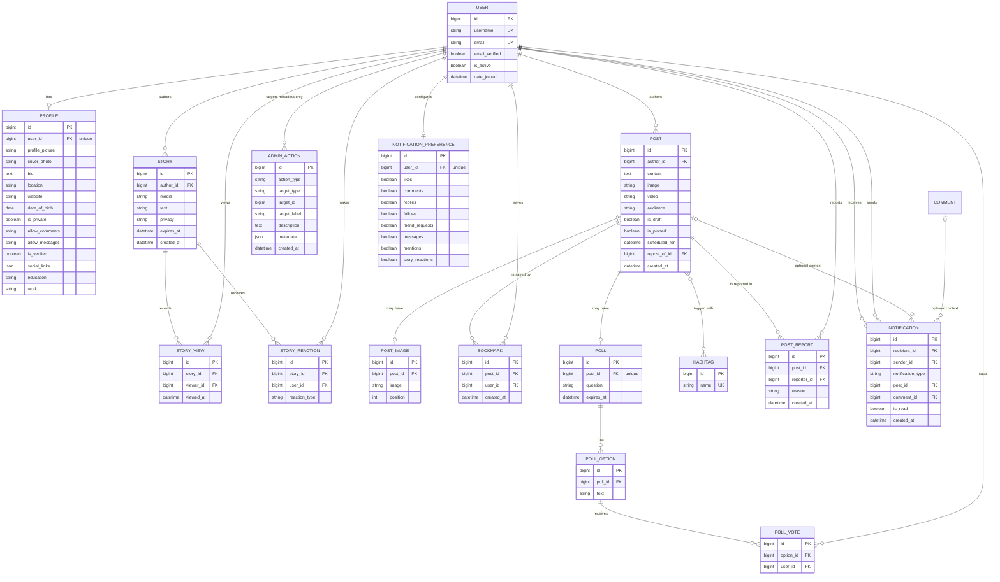
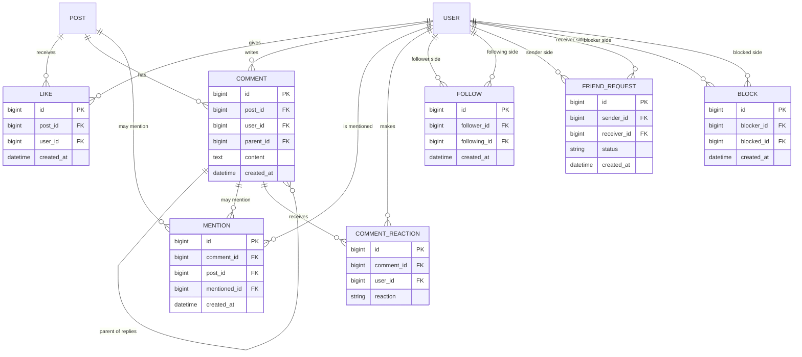
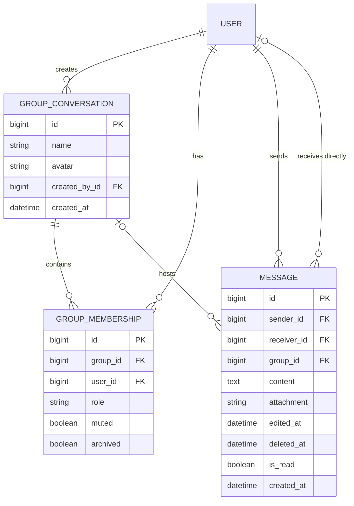

# ER Diagram

The diagrams below reflect the current Django model source. All primary keys are implicit `BigAutoField` IDs. Optional FKs are shown with `o{`/`|o` style relationships. For full field options, see `DATABASE_DESIGN.md`.

## Core identity, content, stories, and notifications

## Social graph

## Chat

## Relationship notes

- `PROFILE.user` and `NOTIFICATION_PREFERENCE.user` are OneToOne; each user has at most one of each.
- `STORY_VIEW(story, viewer)`, `STORY_REACTION(user, story)`, `BOOKMARK(post, user)`, `LIKE(post, user)`, `FOLLOW(follower, following)`, `COMMENT_REACTION(comment, user)`, and `GROUP_MEMBERSHIP(group, user)` are explicitly unique.
- `BLOCK` and `FRIEND_REQUEST` also have check constraints preventing self-referential rows.
- `FRIEND_REQUEST(sender, receiver)` is unique per direction; a reverse request is a separate row and is handled by the view.
- `POLL_VOTE` is unique per `(option, user)`, **not** per `(poll, user)`; one-vote-per-poll is enforced in the view, not the database.
- `MESSAGE` may target either `receiver` or `group`; the schema does not enforce exactly one. Every read path must exclude soft-deleted rows.
- `MENTION` may reference a comment or a post; the schema does not enforce exactly one.
- `POST.repost_of` is a self-FK with `SET_NULL`, preserving reposts when the source is deleted.
- M2M relations: `STORY.viewers` through `StoryView`, `HASHTAG.posts`, `GROUP_CONVERSATION.members` through `GroupMembership`.
