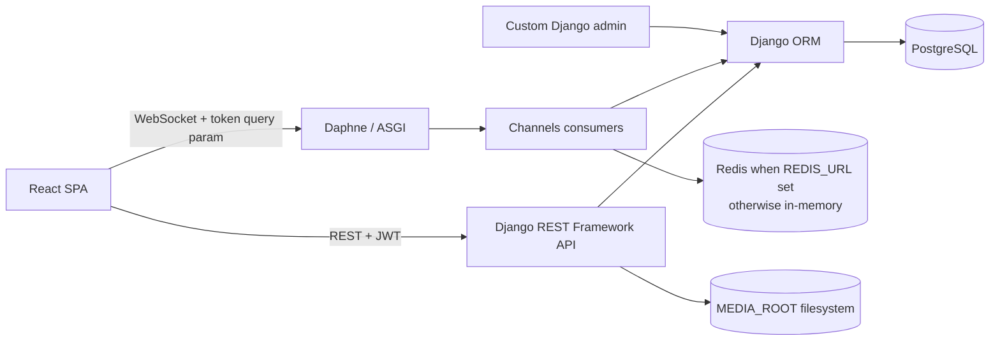

# Project Overview

## Product identity

The workspace implements **SocialConnect**, a full-stack social networking application. The backend is a Django REST Framework API with Django Channels WebSockets; the frontend is a Vite/React single-page application. A customized Django admin site provides moderation/analytics screens.

The project root is:

```text
C:\Django project\social media app
```

The root contains the React SPA, the Django project, documentation snapshots, Postman resources, environment templates, dependency manifests, and two nested Git repositories (root and `backend/`) with no commit history in this checkout.

## System shape



### Request path

- The SPA calls `http://127.0.0.1:8000/api/` by default; `VITE_API_BASE_URL` overrides it.
- `config/urls.py` mounts five API groups: `api/users/`, `api/posts/`, `api/social/`, `api/notifications/`, and `api/chat/`.
- DRF uses JWT authentication by default. SimpleJWT refresh tokens rotate and are blacklisted after use.
- PostgreSQL is mandatory; no SQLite fallback is present.
- Media files are served from `MEDIA_URL` only when `DEBUG` is enabled.
- WebSockets require an ASGI server such as Daphne (`config.asgi:application`), not WSGI.

### Real-time path

- `ws/chat/<user_id>/` connects to `chat.consumers.ChatConsumer`.
- `ws/notifications/` connects to the notification consumer.
- Both pass the access token as `?token=<access>`; `chat.middleware.JWTAuthMiddleware` validates it.
- Notifications are published through `notifications.utils.create_notification`, which checks blocks and per-category preferences before persistence and WebSocket delivery.
- The channel layer uses Redis when `REDIS_URL` is configured; otherwise it is in-memory. In-memory state is not shared across ASGI worker processes.

## Module responsibilities

| Layer | Module | Responsibility |
| --- | --- | --- |
| Project config | `backend/config/` | Settings, root URLs, ASGI/W custom admin, health JSON route, admin metrics. |
| Identity | `backend/users/` | Registration/login/logout, JWT refresh, profile, password reset/change, deactivation, search, stories, story views/reactions, `Profile` via signal. |
| Content | `backend/posts/` | Posts and images, audience/drafts/pinning/scheduling/reposts, bookmarks, polls and votes, hashtags, reports. |
| Social graph | `backend/social/` | Likes, comments and replies, follows, friend requests, friends, mutual friends, blocks, feed visibility, mentions, comment reactions. |
| Notifications | `backend/notifications/` | Notification records, unread counts, read actions, per-category preferences, WebSocket push. |
| Messaging | `backend/chat/` | Direct-message REST history/read state/unread counts, group conversation REST endpoints, direct WebSocket chat. |
| Admin | `backend/config/admin_site.py`, `admin_metrics.py`, templates/static | Custom dashboard, analytics, roles, system pages, moderation views. |
| SPA shell | `frontend/src/App.jsx`, `components/AppShell.jsx`, `components/navbar.jsx` | Routing, auth guard, navigation, profile store, unread counters, theme, notification settings. |
| SPA API | `frontend/src/api/axios.js`, `profileStore.js` | Axios instance, bearer token injection, 401 refresh/blacklist handling, profile cache. |
| SPA pages/components | `frontend/src/pages/`, `frontend/src/components/` | Auth, home feed, profiles, search, messages, notifications, bookmarks, stories, posts/comments. |

## Implementation summary

### Strongly implemented

- JWT auth lifecycle including refresh with rotation and blacklisting.
- Profile CRUD, password change/reset, account deactivation.
- Posts with images, audience, drafts, pinning, reposts, bookmarks, polls, reports, hashtags.
- Likes, threaded comments/replies, follows, friend requests, friends, mutual friends, blocks.
- Feed visibility/audience/block filtering through a centralized `social/access.py`.
- Notification creation, preferences, REST read flows, unread count, WebSocket push.
- Direct chat REST history plus WebSocket messaging; group conversation REST endpoints.
- Stories with privacy, expiry, views, and reactions.
- Responsive SPA shell with desktop sidebar/right rail, mobile drawer/bottom nav, dark mode, dialogs, focus trapping, skeletons, and media viewer.

### Partially implemented

- Group chat has REST endpoints and models but no dedicated group WebSocket consumer in the inspected source.
- Polls, hashtags, scheduled posts, some report flows, comment reactions, mentions, and group conversations are backend features with little or no SPA surface.
- Notification preferences are exposed in a SPA dialog; other backend notification categories are surfaced mainly through the notification list.
- Some admin moderation flows depend on model state that is incomplete (for example, reports lack a status field).
- Historical docs mention several features that are not reachable in the current SPA.

### Not Found / Needs Verification

- No `/explore` or `/settings` SPA route; exploration is `/search`, and settings are dialogs.
- No production static-file serving configuration in source; media serving is DEBUG-only.
- No committed API schema (OpenAPI/Swagger) route was found.
- No frontend test files or `npm test` script despite Vitest/jsdom dependencies.
- No evidence that multiple ASGI workers are deployed; with in-memory channel layer, cross-process WebSocket fan-out would fail.

## Readiness assessment

| Dimension | Assessment |
| --- | --- |
| Functional breadth | High for a university project: core social flows are broad and mostly wired. |
| Backend/SPA integration | Strong for primary flows; several backend-only capabilities remain. |
| Real-time | Implemented, but production topology is environment-dependent. |
| Security baseline | Reasonable Django/DRF defaults plus JWT; token-in-localStorage and query-string WS tokens remain notable risks. |
| Testing | Substantial backend test suite; no frontend tests; full-suite result not claimed here. |
| Deployment | Needs verification: no production web server/static/media configuration found in source. |
| Documentation quality | Strong audit material now available; existing root reports are historical snapshots. |

## Recommended report framing

Present the application as a **feature-rich prototype / advanced coursework project** with a production-ready architectural foundation but incomplete production hardening. Emphasize the centralized privacy helpers, notification pipeline, and responsive SPA, while being candid about backend-only features, missing frontend tests, deployment gaps, and prioritized security recommendations.
