# System Architecture

## Scope

This document describes the architecture observable in the current source tree. It covers HTTP/REST, WebSocket, authentication, persistence, frontend state, admin, channel-layer topology, and deployment boundaries. Runtime deployment claims are marked `Needs Verification`; no secret values or environment file contents are reproduced.

---

## 1. Logical architecture

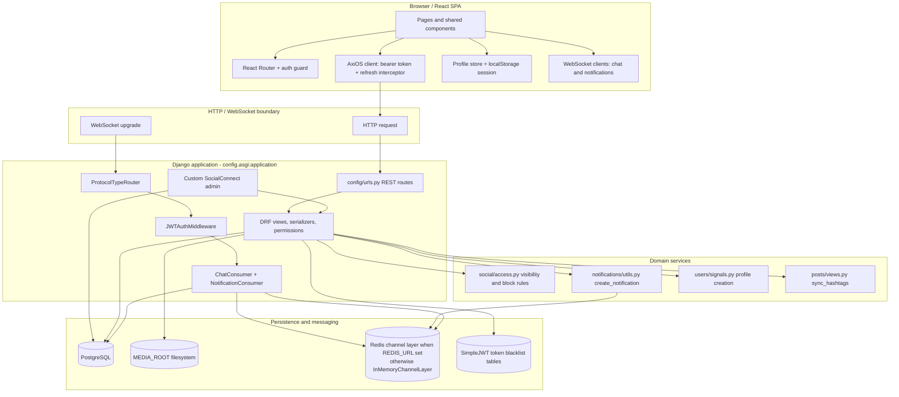

### Component responsibilities

| Component | Responsibility | Source boundary |
| --- | --- | --- |
| React router | Public auth routes, protected app routes, redirect fallback | `frontend/src/App.jsx` |
| App shell | Navbar, sidebar, right rail, mobile drawer/bottom nav, unread counters | `frontend/src/components/AppShell.jsx`, `navbar.jsx` |
| API client | Bearer injection, 401 refresh, session clearing, media URL resolution | `frontend/src/api/axios.js` |
| Profile store | External-store cache with subscription and in-flight de-duplication | `frontend/src/api/profileStore.js` |
| DRF views | CRUD, toggles, list/feed filtering, permission enforcement | `backend/{users,posts,social,notifications,chat}/views.py` |
| Serializers | Input validation, output shaping, privacy masking | `*/serializers.py` |
| Access helpers | Centralized visibility, audience, block, and chat-policy checks | `backend/social/access.py` |
| Notification utility | Preference/block checks, persistence, on-commit WebSocket publish | `backend/notifications/utils.py` |
| Consumers | Direct chat and notification WebSocket protocol handling | `backend/chat/consumers.py`, `backend/notifications/consumers.py` |
| Admin site | Dashboard, analytics, roles, system status, model changelists | `backend/config/admin_site.py`, `admin_metrics.py` |
| PostgreSQL | System of record | `config/settings.py` DATABASES |
| Channel layer | Cross-connection/group fan-out | `config/settings.py` CHANNEL_LAYERS |

---

## 2. Process and server topology

### Source-defined topology

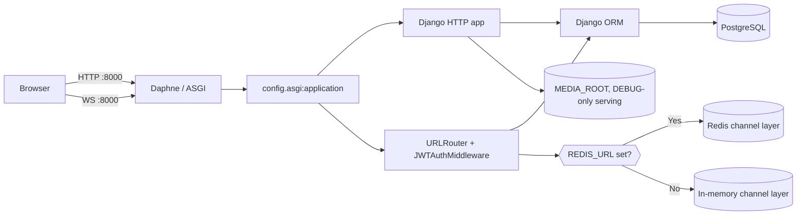

- **HTTP:** Standard Django views through `config/urls.py`; DRF mounts five API prefixes under `/api/`.
- **WebSocket:** `config/asgi.py` uses `ProtocolTypeRouter` with `JWTAuthMiddleware(URLRouter(...))`. `wsgi.py` has no WebSocket support.
- **Database:** PostgreSQL is mandatory. There is no SQLite fallback.
- **Channel layer:** Redis is selected only when `REDIS_URL` is present; otherwise an in-memory layer is used.
- **Media:** Served by Django only when `DEBUG` is enabled. No production static/media host is configured in source.
- **SPA:** Vite serves during development; the production build output is not served by a checked-in Django route or deployment config.

### Development vs production implication

| Concern | Development (source-default) | Production requirement |
| --- | --- | --- |
| App server | Daphne/ASGI for WebSockets | Daphne or another ASGI server behind a reverse proxy. |
| Channel layer | In-memory acceptable for one process | Redis required for multiple workers/processes. |
| Media | Django DEBUG static route | Dedicated media server/CDN or authenticated endpoint. |
| SPA | Vite dev server at 5173 | Static hosting with history fallback to `index.html`. |
| Secrets | Root `.env` | Secret manager / environment injection; `DEBUG=False`. |
| CORS | Localhost origins by default | Explicit production SPA origin. |

---

## 3. REST request lifecycle

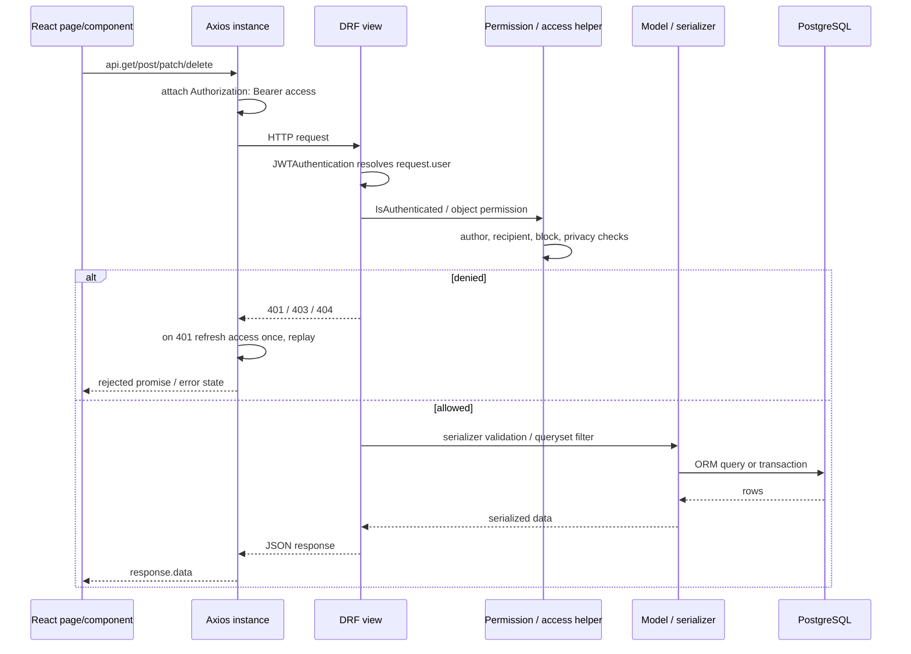

### Cross-cutting REST behaviours

- **Authentication failure:** The Axios interceptor refreshes once, replays the original request, and clears session on refresh failure.
- **Privacy:** `social/access.py` centralizes `visible_posts`, `posts_for_detail`, `visible_stories`, `can_view_profile`, `can_message_user`, `can_chat_between`, and block ID helpers.
- **Notifications:** Domain views call `create_notification` rather than constructing notifications directly.
- **Hashtags:** `sync_hashtags` runs on post create/update from `#tag` tokens.
- **Soft deletion:** Chat reads exclude `Message.deleted_at` non-null.
- **Pagination:** Only the news feed paginates, and only when `?page=` is present.

---

## 4. Authentication and token lifecycle

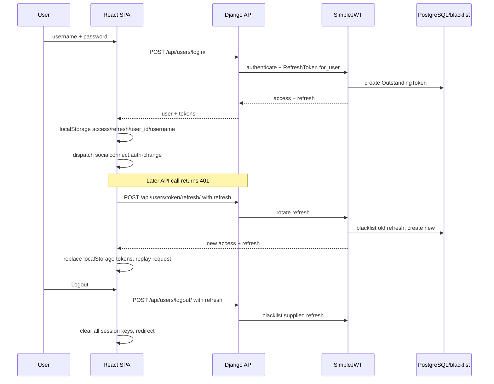

### WebSocket authentication

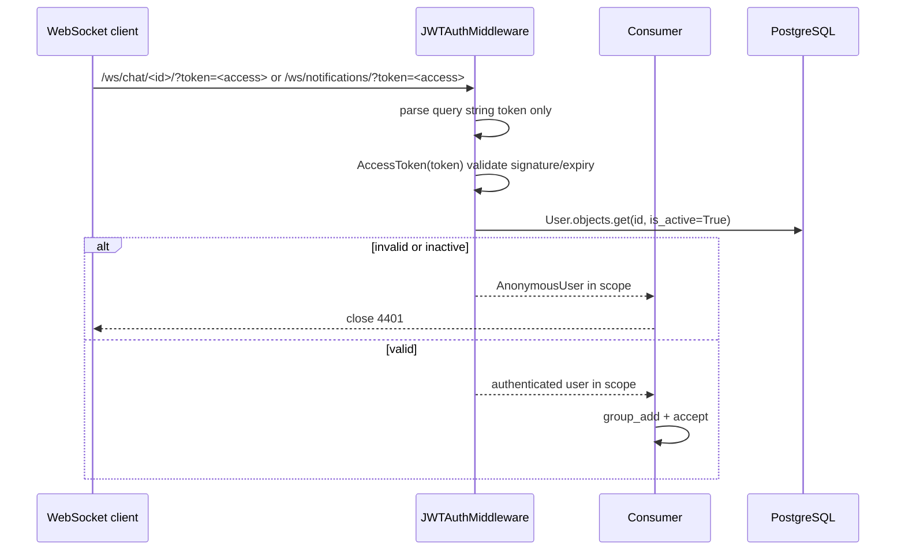

**Architectural note:** WebSocket tokens are supplied in the query string because the middleware reads `?token=`; HTTP Authorization headers are not used for sockets. This is convenient for browser WebSocket APIs but is a log-leak risk documented in `SECURITY_ANALYSIS.md`.

---

## 5. Real-time architecture

### Chat message flow

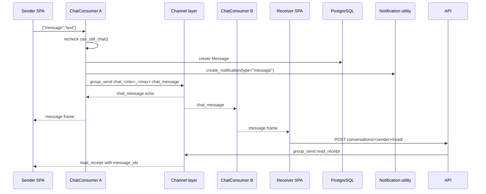

Additional direct-chat event paths:

- Typing: `{"type":"typing","is_typing":bool}` → `typing_update` → peer `typing`.
- Presence: accept/disconnect → `presence_update` → peer `presence`.
- REST edit/delete: `MessageDetailView` broadcasts `message_updated` / `message_deleted` to direct-message group only.
- REST attachment send: posts `FormData`, persists, notifies, and broadcasts through `chat/utils.py`; payload differs slightly from consumer broadcast.

### Notification publish flow

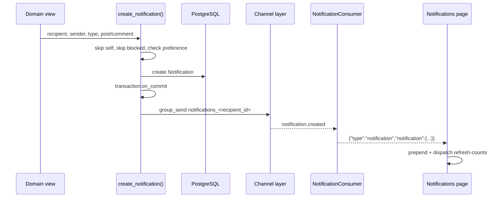

**Gap:** Marking a notification read updates the database and local SPA state but emits no WebSocket event. Other open tabs/clients must poll or refresh.

### Channel-layer topology

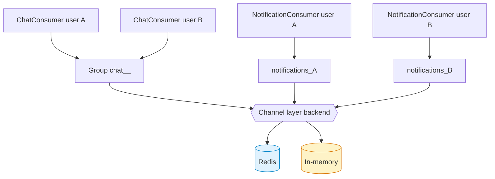

- With **one ASGI process**, in-memory groups work.
- With **multiple workers/processes**, only Redis-backed groups are shared. Without `REDIS_URL`, events from one worker do not reach sockets held by another.
- Group names are deterministic: direct chat uses sorted user IDs; notifications use recipient ID.

---

## 6. Frontend architecture

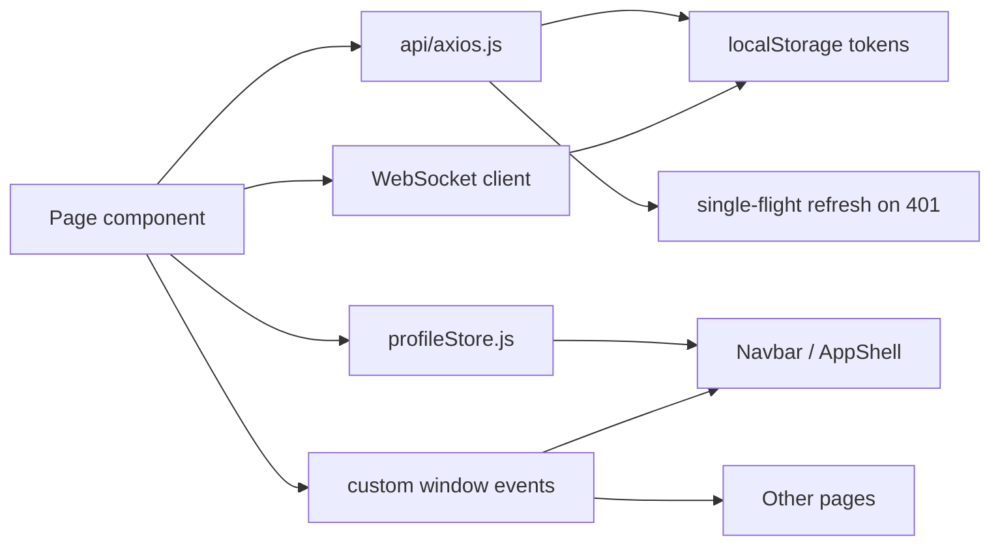

### State ownership

| State | Owner | Notes |
| --- | --- | --- |
| Session tokens and identity | `localStorage` | Shared by API client, route guard, WebSocket connectors, pages. |
| Profile cache | `profileStore.js` external store | Navbar/AppShell subscribe; `force` refresh on profile-change/auth-change. |
| Feed data | `home.jsx` | Page-level pagination and local post mutation. |
| Comments | `PostActions.jsx` | Lazy loaded per post, local edit/delete state. |
| Messages | `Messages.jsx` | REST history merged with WebSocket frames. |
| Notifications | `Notifications.jsx` | REST list plus live WebSocket prepend. |
| Theme | `navbar.jsx` + admin JS | Separate keys for SPA and admin themes. |
| Unread counters | Navbar polling | Not event-driven from server. |

### Architectural strengths

- Shared API client centralizes auth/refresh behaviour.
- Shared components centralize dialogs, media viewing, avatars, and icons.
- Several pages use `AbortController` and StrictMode guards to avoid duplicate/stale requests.
- Custom events coordinate profile, auth, and count refreshes without a global state library.

### Architectural weaknesses

- No centralized server-state cache; list pages implement loading/error/pagination independently.
- Many pages reuse a single `error` state across unrelated operations.
- Route guard checks token presence only.
- WebSocket URL construction duplicates origin conversion logic in two pages.
- Dead `Profile.jsx` and duplicated CSS reduce coherence.

---

## 7. Data access and privacy boundary

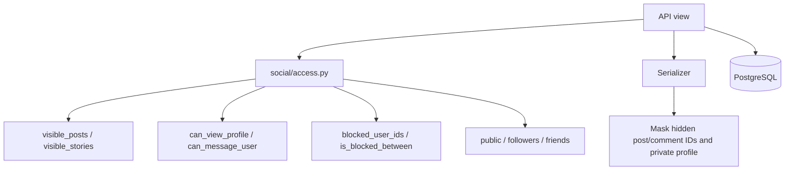

- Privacy decisions should be made through `social/access.py`; historical guidance explicitly warns against reimplementing filters in views.
- Notification delivery respects the same block concept plus per-category preference opt-outs.
- Chat uses `can_chat_between`, requiring messaging to be allowed in both directions.
- Media files themselves are not authorization-aware; access control applies to API metadata, not direct file URLs.

---

## 8. Admin architecture

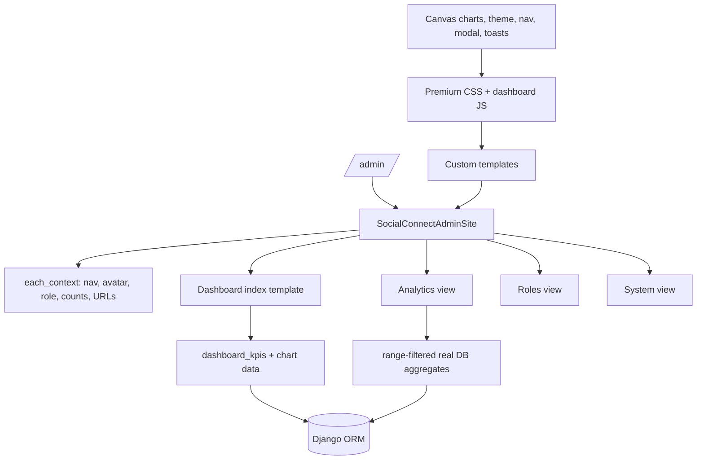

- The admin is a custom Django site, not part of the React SPA.
- Dashboard exposes 12 KPI cards derived from real tables.
- Analytics supports `?range=7|30|90`; invalid values fall back to 30 days.
- Roles are display-only; Django groups/permissions remain authoritative.
- System status reports verifiable runtime facts and does not display secrets.
- Permission gating is implemented for analytics/charts and model data. Browser verification remains historical/partial.

---

## 9. Media architecture

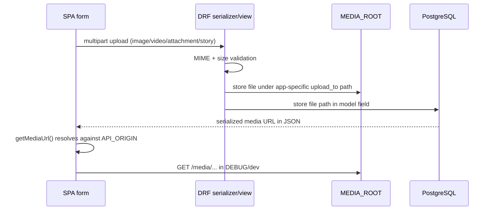

Upload paths observed: `profile/`, `cover/`, `stories/`, `posts/images/`, `posts/videos/`, `chat/attachments/`, `chat/groups/`. Production media authorization/hosting is **Not Found** in source.

---

## 10. Failure modes and resilience

| Failure | Current behaviour | Architectural implication |
| --- | --- | --- |
| Access token expires | Axios refreshes on 401 and replays once | Good HTTP resilience; no equivalent transparent WS token refresh. |
| Refresh token reused/expired | Session keys cleared, redirect to `/login` | Correct security response. |
| WS token invalid/inactive | Close 4401; SPA schedules reconnect | Reconnect loop may continue until token is updated in localStorage. |
| Channel layer in-memory + multiple workers | Events localized to one process | Real-time delivery inconsistent; Redis required in production. |
| Password reset email backend misconfigured | API still returns generic success | User may never receive link; monitoring missing. |
| Notification target blocked after creation | Serializer masks `post`/`comment` to null | Privacy-preserving, but UI target may fall back to `/`. |
| Message soft-deleted | Queries exclude non-null `deleted_at` | Correct, but every new query must remember the filter. |
| Large media upload rejected client-side | Client blocks before request | Backend validation also expected; exact validators need targeted review. |
| Search request aborted then repeated | Ref/cache bug can leave loading stuck | Known frontend defect. |

---

## 11. Architectural decisions and trade-offs

| Decision | Benefit | Cost / risk |
| --- | --- | --- |
| Django REST Framework + Django Channels in one project | Shared ORM, auth, admin, and domain logic | ASGI requirement; channel-layer topology must be managed. |
| JWT access/refresh with rotation | Stateless API auth, revocation via blacklist | Token storage in browser JS; refresh complexity. |
| Centralized access helpers | One privacy policy for feeds/profiles/chat | Raw ORM queries outside helpers could bypass intent. |
| Channel-layer notifications via `on_commit` | Avoids publishing before transaction commit | Requires correct transaction usage; no read-state push. |
| SPA localStorage session | Simple implementation and cross-tab sync | XSS exposure; query-string WS tokens. |
| Hand-written CSS | Full design control and no UI dependency | ~13.8k CSS lines with duplicated blocks. |
| Optionally in-memory channel layer | Zero-dependency local development | Not safe for multi-process production. |
| Custom admin analytics | Real-time operational insight without separate BI tool | Browser verification absent; some KPI semantics incomplete. |

---

## 12. Deployment readiness assessment

| Requirement | Source status |
| --- | --- |
| ASGI entrypoint | Present: `config.asgi:application`. |
| WSGI entrypoint | Present but unsuitable for WebSockets. |
| PostgreSQL configuration | Present via environment variables; mandatory. |
| Redis channel layer | Supported via `REDIS_URL`; not required by source-default local setup. |
| Production static SPA serving | Not Found. |
| Production media serving | Not Found; DEBUG-only media route present. |
| Reverse proxy/TLS config | Not Found; settings support proxy/HSTS flags. |
| Process manager / container config | Not Found in pruned source tree. |
| CI/CD config | Not Found. |
| Health endpoint | Root JSON response present. |
| Secrets management | Environment template present; local `.env` ignored; production mechanism Needs Verification. |

**Conclusion:** The source defines a coherent application architecture but not a complete production deployment architecture. The main scaling dependency is Redis; the main security deployment gap is browser-stored tokens and DEBUG-dependent media serving.

---

## 13. Architecture review verdict

| Dimension | Rating | Rationale |
| --- | --- | --- |
| Modularity | Strong | Five Django apps plus clear frontend layers. |
| Separation of concerns | Strong | Access helpers, notification utility, serializers, consumers, admin metrics. |
| Real-time design | Good | Direct chat and notifications are well structured; group real-time incomplete. |
| Authorization model | Good | Object-level checks and block-aware queries; some UI assumptions. |
| Frontend integration | Good | Shared client/components, but duplicated state handling and no test suite. |
| Operational readiness | Weak | No deployment config; channel-layer topology environment-dependent. |
| Maintainability | Moderate | Large duplicated CSS, dead code/files, stale reports. |

The architecture is appropriate for an advanced university project and a functional prototype. Production readiness requires explicit deployment topology, Redis, secure token transport, media authorization, rate limiting, and frontend automated tests.
