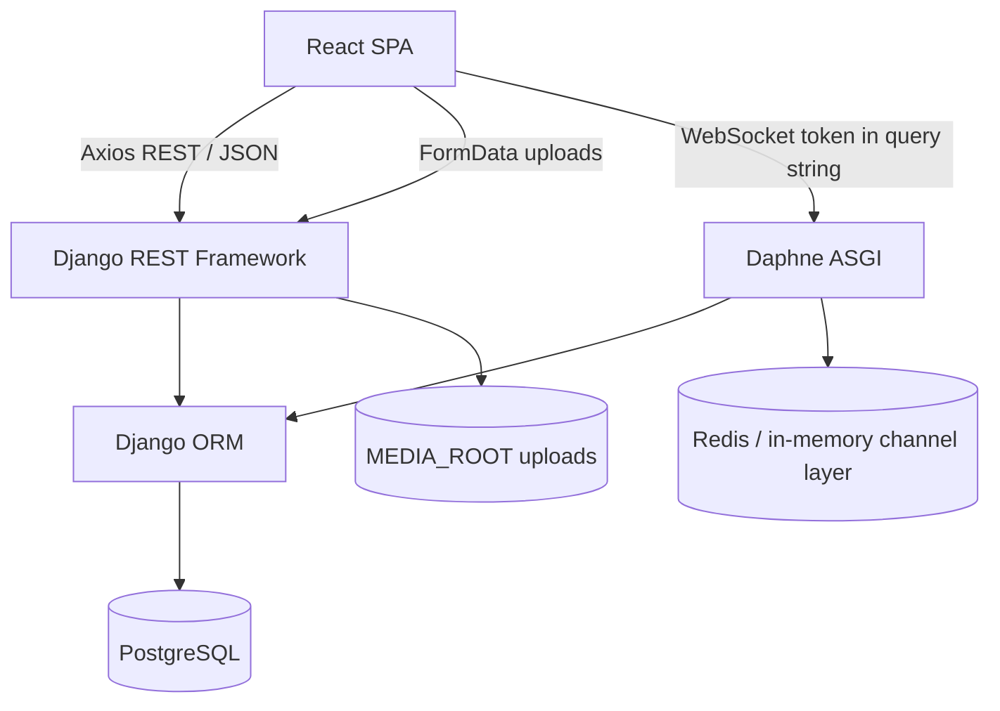

# Technology Stack

## Summary

SocialConnect is a JavaScript/Python full-stack application with a clear separation between a React SPA and a Django REST/Channels API. PostgreSQL is the system of record; Redis is optional but expected for multi-process WebSocket fan-out. The SPA is built with Vite and talks to the API over JWT-authenticated REST plus direct WebSockets.

## Backend

| Concern | Technology / version | Evidence |
| --- | --- | --- |
| Language runtime | Python 3.13 (root `venv/`) | Workspace and backend `AGENTS.md`. |
| Web framework | Django 6.1 | `backend/requirements.txt`; `config/settings.py`. |
| REST toolkit | djangorestframework 3.18.0 | `backend/requirements.txt`; DRF settings. |
| Authentication | djangorestframework_simplejwt 5.5.1 (PyJWT 2.13.0) | JWT settings; token refresh route; WebSocket middleware. |
| WebSockets | channels 4.3.2, channels_redis 4.3.0 | `config/asgi.py`, consumers, routing, middleware. |
| ASGI server | daphne 4.2.3, Twisted 26.4.0 | `backend/requirements.txt`; AGENTS notes ASGI requirement. |
| Database driver | psycopg2-binary 2.9.12 | `backend/requirements.txt`; PostgreSQL settings. |
| Database | PostgreSQL (mandatory) | `DB_NAME`, `DB_USER`, `DB_PASSWORD`, `DB_HOST`, `DB_PORT` configuration. No SQLite fallback found. |
| Image processing | Pillow 12.3.0 | `backend/requirements.txt`; image fields/serializers. |
| CORS | django-cors-headers 4.9.0 | Middleware/settings; cross-origin SPA support. |
| Environment loading | python-dotenv 1.2.2 | `config/settings.py` loads only the root `.env`. |
| Cache/channel layer | redis 8.1.0 | `REDIS_URL` selects Redis channel layer; otherwise in-memory. |
| Admin | Django admin with custom site/templates/static | `config/admin.py`, `admin_site.py`, `templates/admin/`, `static/admin/`. |

### Installed but not wired into application routes

`backend/requirements.txt` also pins `fastapi`, `starlette`, `uvicorn`, `pydantic`, `pydantic_core`, `h11`, `anyio`, `annotated-doc`, and related packages. No FastAPI application, routers, or endpoints were found in the inspected project source. They appear to be unused dependencies; `Needs Verification` for any external tool that might import them.

`backend/requirements.txt` is the authoritative dependency file. Root `requirements.txt` is an older/partial duplicate and is missing packages such as `redis` and `Twisted`.

## Frontend

| Concern | Technology / version | Evidence |
| --- | --- | --- |
| Build tool | Vite 8.3.6 | `frontend/package.json`, `vite.config.js`. |
| UI runtime | React 19.3.1, react-dom 19.3.1 | `frontend/package.json`; JSX source. |
| Routing | react-router-dom 7.18.5 | `src/App.jsx` uses `BrowserRouter`, `Routes`, guards. |
| HTTP client | axios 1.21.0 | `src/api/axios.js` with interceptors. |
| React plugin | @vitejs/plugin-react 6.1.2 | `vite.config.js`. |
| Linting | ESLint 10.14.0 with `@eslint/js`, react-hooks, react-refresh plugins | `eslint.config.js`. |
| Test libraries | Vitest 5.1.1, jsdom 31.0.1, @testing-library/react 16.3.3, @testing-library/jest-dom 8.0.0 | Dev dependencies only; no test files or `npm test` script found. |
| Styling | Hand-written CSS in `src/index.css` and `src/App.css` | CSS custom properties, dark theme, responsive breakpoints. |
| Icons | Inline SVG via `components/Icon.jsx` | No icon library dependency. |
| PWA assets | `public/manifest.webmanifest`, `public/sw.js`, SVG icons | Registered only in production in `src/main.jsx`. |

### Frontend scripts

Defined in `frontend/package.json`:

- `npm.cmd run dev` — Vite development server.
- `npm.cmd run build` — production bundle.
- `npm.cmd run lint` — ESLint over the project.
- `npm.cmd run preview` — preview built bundle.

`npm.cmd` is required on this machine because plain `npm` resolves to a PowerShell script blocked by execution policy.

## Runtime configuration

### Backend environment variable names only

The root `.env` is local and was not opened or reproduced. Source and templates reference these variable **names**:

- Django/security: `DJANGO_SECRET_KEY`, `DJANGO_DEBUG`, `DJANGO_ALLOW_INSECURE_DEVELOPMENT`, `DJANGO_ALLOWED_HOSTS`, `FRONTEND_URL`, `CORS_ALLOWED_ORIGINS`, `DJANGO_USE_HTTPS_PROXY`, `DJANGO_SECURE_HSTS_SECONDS`, `DJANGO_SECURE_HSTS_INCLUDE_SUBDOMAINS`, `DJANGO_SECURE_HSTS_PRELOAD`.
- Database: `DB_NAME`, `DB_USER`, `DB_PASSWORD`, `DB_HOST`, `DB_PORT`.
- Channels: `REDIS_URL`.
- JWT lifetimes: `JWT_ACCESS_MINUTES`, `JWT_REFRESH_DAYS`.
- Exact effective values are environment-dependent and are not asserted here.

`DJANGO_SECRET_KEY` is required unless both DEBUG and the insecure-development override are enabled. PostgreSQL is mandatory. Media files are served through Django only when `DEBUG` is true.

### Frontend environment variable names

- `VITE_API_BASE_URL` — REST base URL; default `http://127.0.0.1:8000/api/`.
- `VITE_API_ORIGIN` — origin used to resolve media URLs and WebSocket hosts; falls back to the API base URL origin.

### Browser-side session storage

The SPA stores `access`, `refresh`, `user_id`, and `username` in `localStorage`, plus `socialconnect-theme` for UI theme. Session expiry clears the first four keys and dispatches `socialconnect:auth-change`. Route guards check only for the presence of `access`.

## Communication protocols



## Development and verification tooling

Backend commands from `AGENTS.md` (run in `backend/`):

```powershell
..\venv\Scripts\python.exe manage.py check
..\venv\Scripts\python.exe manage.py makemigrations --check --dry-run
..\venv\Scripts\python.exe manage.py test --keepdb
..\venv\Scripts\python.exe manage.py test social --keepdb
```

Frontend checks from `frontend/`:

```powershell
npm.cmd run lint
npm.cmd run build
```

There is no root-level test runner, pytest/tox configuration, or frontend test suite.

## Architectural fit assessment

- The selected stack is coherent for a coursework-scale social network: DRF supplies the domain API, Channels adds real-time features, and React supplies a responsive SPA.
- The main operational gap is deployment: production static hosting, media serving, ASGI process management, Redis topology, and secrets management are not represented by checked-in deployment configuration.
- The presence of unused FastAPI/uvicorn dependencies and duplicated CSS suggests historical experimentation that was not fully removed.
